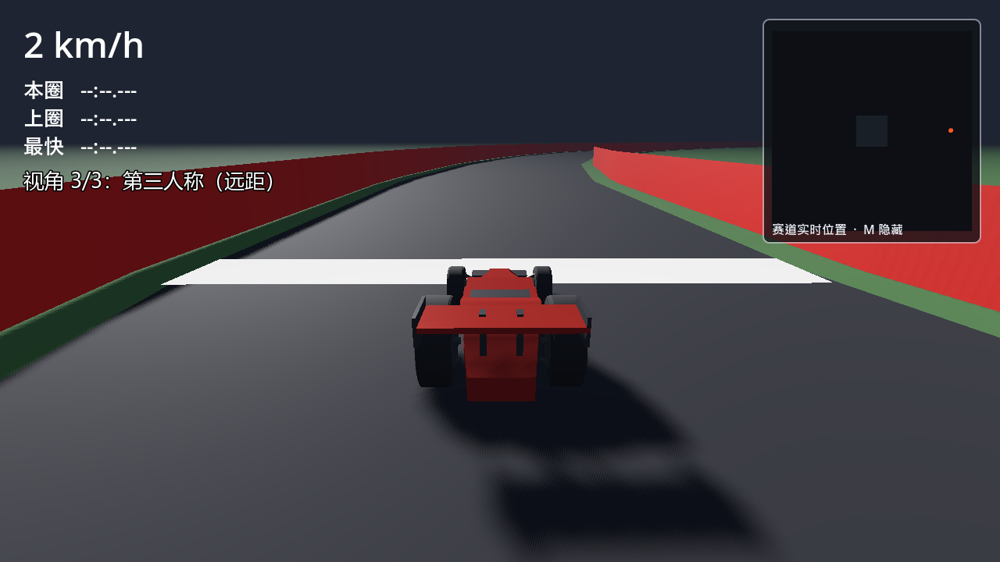
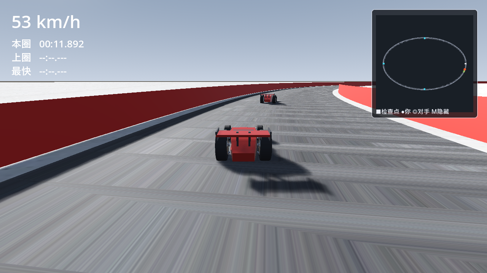

# Godot Racer

Godot Racer 是一款包含 **5 个关卡**的单机 3D 赛车游戏。玩家从开阔的晴天赛道起步，逐渐驶入雨夜、沙尘与雪地；路面抓地力、道路宽度、弯道和障碍的变化，让同一套驾驶操作在每关产生不同的取舍。每关都可以与一台 AI 赛车同场竞速，完成目标圈数后查看成绩，选择重开或挑战下一条赛道。

项目使用 Godot 4.4.1 制作。Windows 首版的本机功能与双帧率跑圈验收已完成，正式交付包由确定的提交快照构建；干净 Windows 环境仍待验证。



## 先玩起来

开发环境需要 Godot 4.4.1 标准 Windows 版。打开 `godot-racer/project.godot`，或从仓库根目录运行：

```powershell
& 'E:\godot\Godot_v4.4.1-stable_win64.exe' --path .\godot-racer
```

进入菜单后选关、调整最高速度与 AI 开关，然后开始比赛。`W/S` 油门与刹车，`A/D` 转向，空格手刹，`R` 复位，`V` 切视角，`M` 切小地图，鼠标右键拖动环视。比赛中 `ESC` 打开暂停菜单；完成目标圈数后显示末圈和最快圈，可重开、返回选关或退出。退出前有确认框。

仓库不提供在线下载的正式 ZIP。`04-Godot启动器/build-release.ps1` 从确定的 Git 提交导出 Windows EXE、独立 PCK、玩家说明、许可文件和 SHA256，产物放在本机 `dist/`；交付前按哈希校验并做导出包冒烟。

## 从上手到挑战

前两关留出宽路和晴天，让玩家先摸清加速、刹车、转向与计圈，再在长直道上尝试更高的速度。雨夜开始降低抓地力并出现障碍：提前减速和选择路线，比单纯踩住油门更重要。后两关继续收窄道路，加入连续弯、动态路障和雪地发夹弯，把已学会的操作组合成完整的一圈。

AI 赛车在玩家起步后才出发，并使用独立车道和障碍避让。这样玩家可以在熟悉赛道的同时观察对手的走线；小地图、复位和圈速反馈则帮助玩家判断失误发生在哪里，并决定下一圈如何调整。具体规则、取舍与验证记录见 [设计记录](godot-racer/docs/portfolio-design.md)、[赛道方案](godot-racer/docs/plans/tracks-and-elevation.md) 和 [AI 对手设计](godot-racer/docs/ai-opponent-design.md)。

## 五关节奏

数据以 `godot-racer/data/levels/*.tres` 为准。抓地力系数是相对倍率，不等于实测轮胎极限。

| 关卡 | 路宽 | 天气／抓地力倍率 | 障碍 | 目标圈数 | 设计作用 |
|---|---:|---|---:|---:|---|
| 新兵训练营 | 14 m | 晴／1.00 | 0 | 2 | 学会基本操作和计圈 |
| 阳光竞速场 | 16 m | 晴／1.00 | 0 | 2 | 在更宽长直道建立速度感 |
| 雨夜街道 | 12 m | 雨／0.70 | 静态 3 | 3 | 第一次同时处理低抓地力与障碍 |
| 荒漠遗迹 | 10 m | 沙尘／0.85 | 静态 6、动态 2 | 3 | 连续弯中判断走线和避让时机 |
| 极地挑战 | 8 m | 雪／0.50 | 静态 4、动态 1 | 3 | 窄路与发夹弯的综合挑战 |



## 当前功能与边界

- 可玩：五关、键盘驾驶、单台 AI 对手、天气影响抓地力、静态及滑动障碍、小地图、暂停、结算、退出确认。雨天播放环境雨声；引擎声是占位实现，尚无背景音乐。
- 设置：默认渲染 60 FPS，菜单可选 120 FPS；物理固定 120 Hz。窗口以 1280×720 为首启目标，按屏幕可用空间缩小，窗口尺寸与帧率保存到 `user://settings.cfg`。60/120 FPS 双档长时跑圈共 18 次通过；主观驾驶手感未实测。
- 未做：手柄支持、游戏内全屏选项、多人、主动超车、障碍随机化、完整音效与商业化内容。
- 已验收：全量 20 行套件、60/120 两档 L4 玩家与 L4/L5 AI 重复冷启动、本机独立目录和雪地制动台架。100 km/h 雪地急刹存在非单调边界，详见 [双帧率报告](godot-logs/rel-final-dualfps-report.md)。待验收：新包的本机冒烟、导出包内实机结算页、主观音频听感、干净 Windows 首启。

## 验证与构建

在 `04-Godot启动器/` 下运行：

```powershell
pwsh -File .\run-settings-test.ps1          # 帧率、窗口、导出资源枚举与菜单
pwsh -File .\run-check.ps1 -Check pause -Level 2
pwsh -File .\run-all-checks.ps1 -Quick -RenderFps 60
pwsh -File .\run-all-checks.ps1 -RenderFps 60
pwsh -File .\build-release.ps1 -DryRun
```

套件共 20 行（Quick 15 行）：两行文档检查、18 行游戏检查；`main.gd` 实现 24 种检查入口，完整判据在 [测试说明](godot-racer/docs/testing.md)。本机发布验收记录为：全量 20/20、结算逻辑 67/67、音频机器断言 37/37、独立目录 21 次运行退出码 0、双帧率跑圈 18/18。原始日志与边界见 [双帧率报告](godot-logs/rel-final-dualfps-report.md)；这些结果绑定生产基线 `518b8e5` 的当前工作区，尚非新交付包的干净提交复跑。

Godot 标准 Windows x64 模板与最小导出 EXE 的 PE 导入表未见 `VCRUNTIME140.dll`、`MSVCP140.dll` 等额外 VC++ Redistributable 动态依赖；最终 EXE 仍须复核。若杀毒软件拦截，先核对 ZIP 的 SHA256 并保留拦截信息交厂商复核，不建议关闭防护。

## 项目资料与许可

- [设计记录](godot-racer/docs/portfolio-design.md)：逐关目标、规则取舍与尚待验证的体验假设。
- [测试说明](godot-racer/docs/testing.md)：检查项、判据、历史结果与未解决边界。
- [导出链路记录](godot-racer/docs/release-export.md)：空场景、PCK 枚举和正式工程五关探针。
- [工程笔记](godot-racer/docs/engineering-notes.md)：问题定位与实现取舍。
- [开发契约](godot-racer/AGENTS.md)：变更、验证和 Git 纪律。

项目自有代码与文档采用 [MIT 许可](LICENSE)。Godot、雨声音频和其它素材的来源边界见 [第三方说明](THIRD_PARTY_NOTICES.md) 与 [随包许可](THIRD-PARTY-LICENSES.md)。
