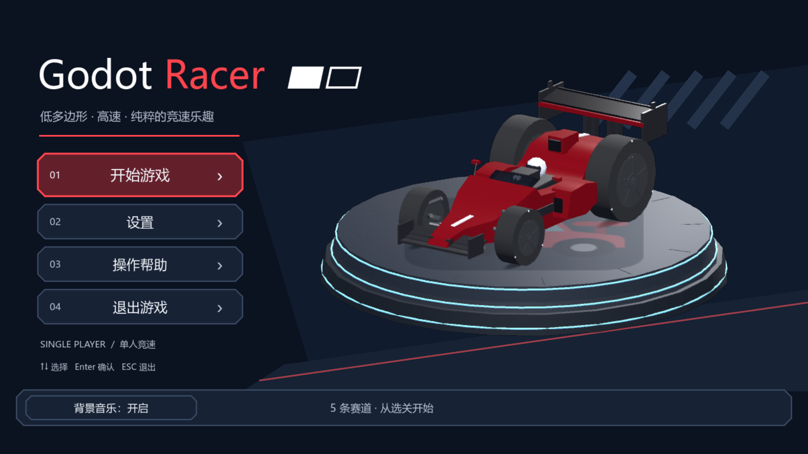
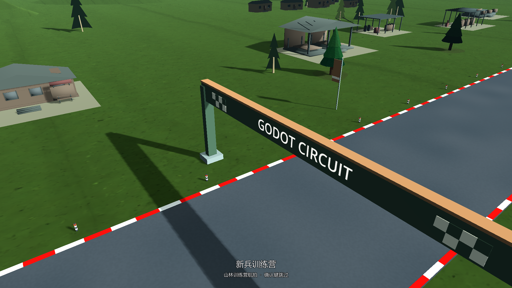
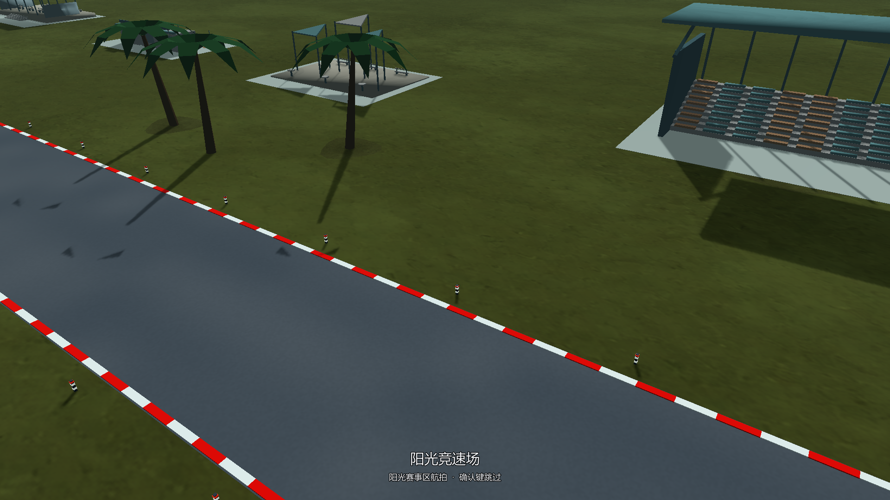
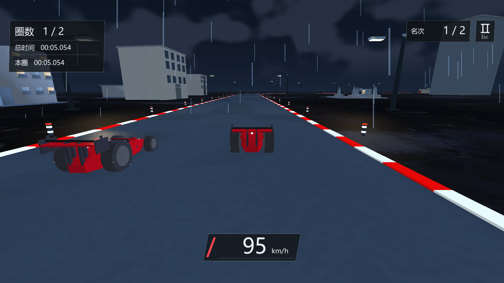
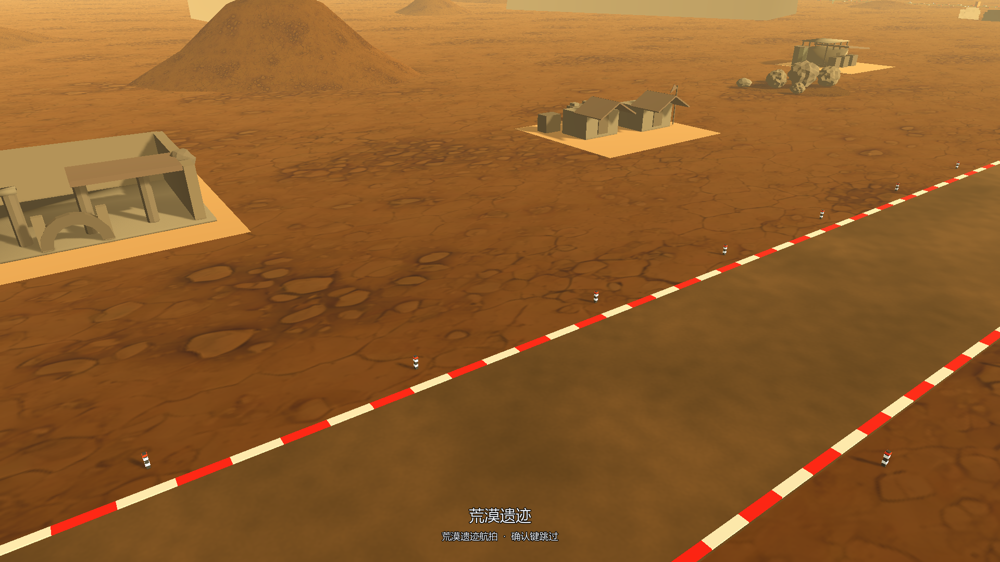
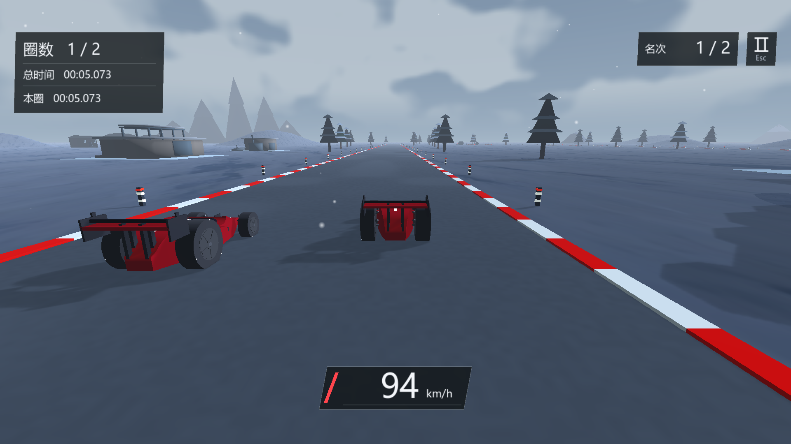
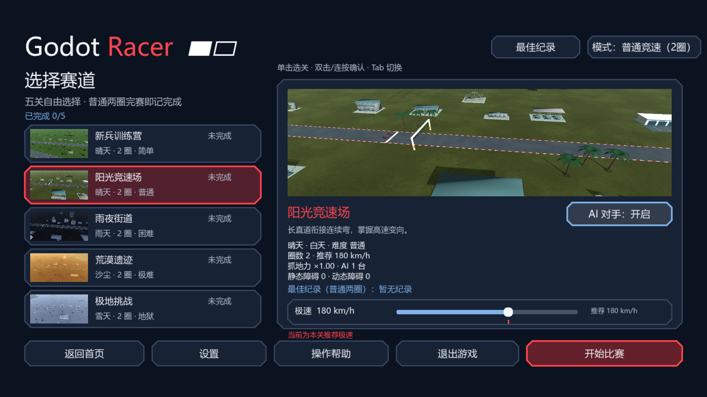

# Godot Racer

### 五条赛道，五种驾驶节奏。

一款使用 **Godot 4.4.1** 开发的低多边形 3D 赛车游戏。驾驶红色赛车，在山林训练营、阳光赛场、雨夜街道、荒漠遗迹与极地雪原之间切换：直道争取速度，弯前选择刹车点，在坡道、湿地和障碍之间找到自己的路线。

**PC 单机 · 真实车辆物理 · 五关自由选择 · 普通两圈 / 无限练习 · 可开关 AI**



> **版本说明 · 2026-11-02**：本页已按当前项目重新编写，图片均为本次从本地开发候选重新采集的引擎画面。本次 GitHub 更新只包含 README 与截图；新界面、幽灵、终点摄影等候选功能的源码尚未同步到公开分支。下文明确标出公开版与开发候选的区别。

## 驾驶体验

- **自由选赛道**：五关从一开始就可选择，不设置逐关解锁。每关有不同的路线、路宽、天气与抓地条件。
- **同一辆车，不同的节奏**：加速、制动、转向、悬挂和碰撞由车辆物理驱动；湿滑与雪地需要更早减速，极速滑条可以按自己的习惯调整。
- **比赛或练习**：普通模式跑两圈后结算；无限模式持续跑圈、比较单圈成绩。AI 可以关闭，方便专注熟悉路线。
- **留下下一次要超越的成绩**：普通模式记录整场最佳时间，无限模式记录最佳单圈，按关卡保存。
- **变化的赛道组合**：常规入场可使用有限的坡度、障碍组合；重试保留本场组合，重新选关可换一种体验。

## 五条主题赛道

项目包含 **5 个关卡**，每条路线都有独立的环境与驾驶目标。

| 赛道 | 环境 | 路宽 | 驾驶重点 |
|---|---|---:|---|
| 新兵训练营 | 山林、训练与维修设施 | 18 m | 熟悉转向、起伏与入弯节奏 |
| 阳光竞速场 | 晴天、看台与赛事服务区 | 16 m | 直道加速与弯前制动 |
| 雨夜街道 | 雨水、街灯与商业街角 | 15 m | 湿地抓地、视野与避障 |
| 荒漠遗迹 | 沙尘、岩石与驿站遗迹 | 14 m | 障碍之间的空间判断 |
| 极地挑战 | 雪原、树林与补给设施 | 13 m | 低抓地组合弯与速度控制 |

以下为本地开发候选的真实画面。航拍取自游戏入场镜头，驾驶图取自自然倒计时后的行驶过程；没有预置圈数或伪造完赛成绩。

| 山林训练营 | 阳光赛场 |
|---|---|
|  |  |
| 雨夜街道 | 荒漠遗迹 |
|  |  |



## 开始一场比赛

1. 从首页进入选关，选择任意赛道。
2. 按需调整最高速度、AI 开关与比赛模式，再开始比赛。
3. 等待入场和倒计时，看到“出发！”后驾驶。普通模式完成两圈进入结算，无限模式可以持续练习。
4. 查看成绩，选择重试或返回菜单。



### 键盘与鼠标

| 操作 | 输入 |
|---|---|
| 加速 | W |
| 制动 / 倒车 | S |
| 左 / 右转向 | A / D |
| 手刹 | 空格 |
| 回到附近安全位置 | R |
| 切换视角 | V |
| 向后看 | 按住 C |
| 环视 | 鼠标右键拖动 |
| 暂停 / 返回 / 退出确认 | Esc |

R 优先使用最近的安全位置，沿当前路线最多回退 30 m；它用于脱困，不增加完成圈数。手柄与移动端的完整体验仍需后续设备验证。

## 公开源码与开发候选

| 内容 | GitHub 当前源码 | 本地开发候选 |
|---|---|---|
| 五关、天气、车辆驾驶、AI 开关、暂停与结算 | 已有 | 已有 |
| 普通 / 无限模式、分关最佳纪录 | 已有 | 已有 |
| 新首页、五关一屏选关、石墨灰驾驶 HUD、动态航拍与加载页 | 仍是此前界面版本 | 已实现，视觉仍在迭代 |
| 自由选关完成标记、完成数量与五关完成反馈 | 待同步 | 已实现；普通两圈完成即可，不要求击败 AI |
| AI 主动超车与可关闭的轻度动态追赶 | 待同步 | 已实现；安全弯速、避障与跟车优先 |
| 个人最佳轨迹幽灵 | 待同步 | 已实现；只记录玩家，复位后不更新本场有效轨迹 |
| 近距离完赛的终点摄影 | 待同步 | 已实现；只表现真实完赛结果 |
| 双人左右分屏、PC 局域网、Android | 未实现 | 后续阶段 |

开发候选中的幽灵以位姿采样回放，呈现对应组合的最佳有效轨迹；它没有车辆碰撞。完成记录、最佳纪录和幽灵分别保存，关闭 AI 的正常两圈练习也可以记录完成。

**当前仍是开发中的项目。** 已完成定向检查和部分自然比赛验证，尚不代表五关全部组合、所有设备或发布版本验收通过。雨雪中的持续驾驶与 AI 自救、部分比赛验证进程的原生退出异常、最终视听与操作手感仍在收口；不承诺稳定帧率或已解决全部崩溃。

## 从源码运行

推荐使用 **Godot 4.4.1 标准版**，在 Windows PC 上打开本项目。

```sh
git clone https://github.com/QieRong/godot-racer.git
cd godot-racer
```

在 Godot 项目管理器中导入仓库里的 `godot-racer/project.godot`，等待资源导入完成后运行主场景。也可以从仓库根目录启动：

```powershell
# 将 godot.exe 换成自己的 Godot 4.4.1 可执行文件路径
& 'C:\Tools\Godot\godot.exe' --path .\godot-racer
```

当前基线为 **Compatibility 渲染器、Jolt 物理、120 Hz 物理更新**。开发主要在 Windows 完成，其他桌面平台尚未逐一验证。仓库没有附带本轮新导出的 EXE、安装包或 Android APK。

### 源码结构

```text
godot-racer/
├─ scenes/       菜单、比赛与车辆场景
├─ scripts/      驾驶、赛道、AI、界面与流程
├─ data/levels/  五关配置
├─ assets/       运行所需的公开资源
├─ tests/        定向回归与场景验证
└─ docs/         设计、工程与测试说明
screenshots/     项目展示画面
```

公开仓库保留可公开的源码与资源。部分本地环境模型、原始素材和制作工程不随仓库提供，因此直接运行公开源码时，部分布景与本页开发候选截图不同；不要据此将第三方素材视为 MIT 授权。

## 接下来的方向

1. 收口 PC 单机的完整比赛、AI、幽灵、摄影与视听体验。
2. 完成 PC 双人左右分屏。
3. 增加 PC 局域网对战。
4. 再进行 Android 输入、布局与真机性能适配。

这些是开发方向，分屏、联网和移动版当前均未完成。

## 许可与项目文档

项目自有代码与文档采用 [MIT License](LICENSE)。第三方音频、贴图、模型与引擎组件分别遵循各自许可；来源和已知边界见[素材来源与第三方说明](THIRD_PARTY_NOTICES.md)及[第三方许可](THIRD-PARTY-LICENSES.md)。请勿将游戏内使用许可理解为可独立提取、再分发素材。

[测试说明](godot-racer/docs/testing.md) · [工程笔记](godot-racer/docs/engineering-notes.md) · [设计说明](godot-racer/docs/portfolio-design.md)

作者：[QieRong](https://github.com/QieRong)
