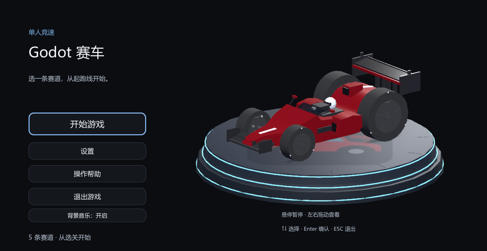
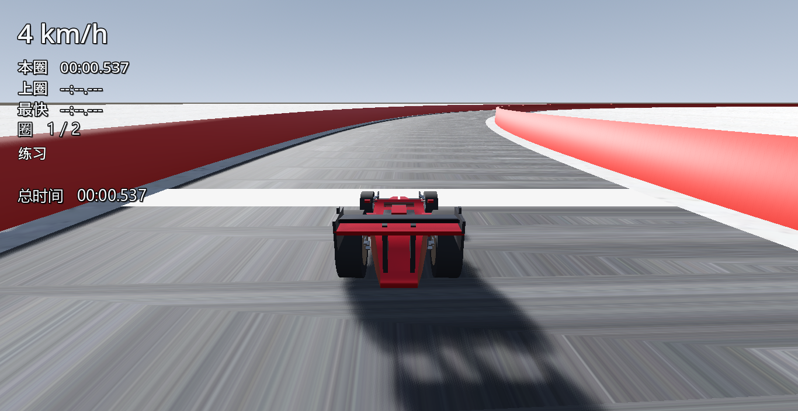

# Godot Racer｜从第一圈开始的赛车策划作品

2026-10-29音频更新：玩家引擎已做三视角距离补偿、弱声像和怠速增益校准；真实录音与专项机器验证通过，耳机/扬声器听感仍待用户确认。第一人称为车头外视角。继续使用Godot 4.4.1；请通过统一“运行游戏.bat”重启，旧EXE不含改动。详见[音频实施与测量](plan/audio-result-20261029.md)。

> 2026-10-28：最新代码、验证边界及私有美术说明见[当前状态](godot-racer/docs/current-status.md)。本次公开PNG图片，新增GLB及建模源文件只保留本地。


Godot Racer 是一款包含 **5 个关卡**的单机 3D 赛车原型：先在晴天宽路熟悉驾驶，再面对雨夜、沙尘、雪地和障碍。你可以开启 AI 竞速，也可以关闭对手练习路线。项目重点展示规则设计、关卡难度递进、界面取舍，以及根据试玩反馈进行迭代的过程。



*本轮候选的实际引擎离屏渲染，1366×705；左下文字已按试玩反馈拉开间距。*

## 第一次玩，先做这四步

1. 打开首页，点击“开始游戏”进入选关。
2. 单击赛道查看天气、圈数、障碍和推荐极速；第一次建议从“新兵训练营”开始，并关闭 AI 练习。
3. 双击赛道，或点击“开始比赛”。等待 3、2、1 和“出发！”；此时开始驾驶与计时。
4. 按顺序通过检查点并完成目标圈数，在结算页查看成绩，再选择重试或返回首页。

首页的“设置”可切换 AI、60/120 FPS 和背景音乐；选关页可调整最高速度。先用推荐值熟悉路线，再尝试自己的调校。

| 操作 | 按键 |
|---|---|
| 加速 / 刹车与倒车 | W / S |
| 左右转向 | A / D |
| 手刹 | 空格 |
| 车辆复位（当前路段最多向后30米） | R |
| 切换视角 | V |
| 按住向后看，松开恢复 | C |
| 拖动环视 | 鼠标右键 |
| 暂停、返回或退出确认 | ESC |

游玩界面已取消小地图，M 键不再绑定功能。圈数、速度、单圈与总时间继续保留。首页展车支持左键拖动；鼠标命中汽车时暂停自转，放在台面或 Logo 上则继续展示。

R优先返回最近记录的安全行驶位置，最多沿当前赛道向后30米；没有合适历史点时，只在此范围内寻找空闲路面。复位扶正、清零速度、朝赛道前进方向，不增加圈数。A/D高速转向已接入提前限舵和渐变响应；机器专项通过，真实驾驶手感待用户确认。请退出旧游戏后重新使用“运行游戏.bat”启动；旧EXE/ZIP不含此修正。



*Godot 4.4.1、Forward+、GeForce 920MX 实际窗口截图；AI 关闭，真实倒计时与“出发”提示结束后采集。*

## 一局比赛围绕哪些决策展开

玩家需要在直道加速、入弯前减速、为障碍留出路线，并判断是否应该使用复位。天气和路宽让相同的油门、刹车与转向产生不同风险；最高速度也是可调整的选择，而不是必须始终踩满的目标。

开启 AI 时，玩家与对手在倒计时结束后同步获得驾驶许可；关闭 AI 时进入练习，不把单人完赛包装成击败对手。成绩区展示总时间、末圈和最快圈，帮助玩家比较下一次尝试。逆行和复位反馈用于解释错误，计圈按实际检查点与压线规则判断。

## 五关如何逐步增加挑战

以下数值来自当前关卡配置，表示设计条件；推荐极速并非实测最优速度。

| 关卡 | 条件 | 圈数 | 希望玩家练习的决策 |
|---|---|---:|---|
| 新兵训练营 | 18 m宽路、Indy结构改编、6/9/12m起伏、1个随机布局路障 | 2 | 建立转向、坡道与刹车节奏 |
| 阳光竞速场 | 16 m宽路、Snetterton 200结构改编、6/10/16m起伏、2个路障 | 2 | 长直道加速与弯前准备 |
| 雨夜街道 | 15 m宽路、Fosters结构改编、8/12/16m起伏、抓地0.70、3个岩石 | 2 | 雨夜提前制动与绕障 |
| 荒漠遗迹 | 14 m宽路、Big Willow结构改编、10/13/16m起伏、6个路障 | 2 | 连续规划路线 |
| 极地挑战 | 13 m宽路、Hungaroring结构改编、8/12/16m起伏、抓地0.50、4个岩石 | 2 | 组合弯的速度与安全距离 |

普通比赛默认随机坡度和障碍：每关3×3有限组合；重试保留、回菜单新开重抽。统一用 `04-Godot启动器/运行游戏.bat`；`--fixed-race`可回到固定对照，平面路线仍固定，动态障碍为0。规则和未通过项见[当前状态](godot-racer/docs/current-status.md)。

## 这个项目展示怎样的策划过程

| 体验目标或反馈 | 落到规则与界面的取舍 | 如何核对 |
|---|---|---|
| 让玩家先理解入口和赛事条件 | 首页与选关分层；单击查看，双击或按钮确认开赛 | 真实控件与页面测试，保留真人体验反馈 |
| 让展车可以看、可以操作 | 车与展台分离拾取；只有汽车响应悬停和拖拽 | 真实3D射线、轮廓间隙和状态切换用例 |
| 让入场有节奏 | 先升起空展台，再渐显并旋转汽车；重进快速恢复 | 时间线断言、实际截图与自动录像 |
| 首页左下文字显得拥挤 | 说明文字下移22个设计像素，音乐开关和输入顺序保留 | 1366×705实测留白由8px增至30px，三尺寸复核 |
| 用户决定取消游玩小地图 | 取消地图世界和HUD面板，移除M动作及帮助说明 | 真实倒计时后游玩检查，验证M和旧CLI均不能恢复它 |

用户负责体验目标、规则取舍、审核与真实试玩反馈；AI辅助代码、资源工具、文档和自动化检查。这里展示可追溯的需求、实现与验证，不虚构玩家研究、商业数据或个人手写经历。当前具体策划记录见[设计说明](godot-racer/docs/portfolio-design.md)、[首页展台方案](godot-racer/docs/current-status.md)与[首页依赖及迭代记录](godot-racer/docs/current-status.md)。

## 当前状态与限制

源码已有五关、键盘驾驶、可关闭的 AI、天气、障碍、暂停、结算和菜单音乐。本轮验证覆盖首页布局/交互、菜单退出、取消小地图和对应截图；历史性能与机器检查均绑定各自版本，详见[测试说明](godot-racer/docs/testing.md)。

用户已反馈首页整体“感觉还行”，并提出文字间距与小地图取舍。最新修改仍需要用户复看；自动截图和录像不能代替真人验收。主观驾驶手感、音乐听感、导出包完整通关和干净 Windows 首启尚未完成本轮验证。编辑器导入/退出的已知诊断和旧红日志保留在相应记录中，不据局部通过宣称整个游戏全绿。

尚未提供手柄、多人和完整商业化内容。本次未重新构建或发布 Windows EXE/ZIP；仓库提供当前源码，已有导出链路供后续验证使用。

## 开发者如何运行和复核

使用 Godot 4.4.1 标准 Windows 版打开 `godot-racer/project.godot`，或在仓库根目录执行：

```powershell
& 'E:\godot\Godot_v4.4.1-stable_win64.exe' --path .\godot-racer --rendering-method gl_compatibility
```

相关验证入口如下，标签须换成新的名称以保留历史证据：

```powershell
python godot-racer/tests/run-minimap-removed.py NEW_TAG --graphics
python godot-racer/tests/run-showcase-delivery.py matrix NEW_LAYOUT_TAG
pwsh -File .\04-Godot启动器\check-readme.ps1
pwsh -File .\04-Godot启动器\check-docs.ps1
```

底层诊断入口按职责保留：场地与恢复 `enclosure`、`layout`、`reset`、`oob`、`escape`、`resetkey`、`wallslide`、`flip`；对手与避障 `opponents`、`avoid`、`obstacles`、`aistart`、`aidiag`；驾驶与流程 `phys`、`weather`、`friction`、`steerbench`、`brakebench`、`stress`、`stuck`、`lap`、`reverse`、`pause`；界面移除回归 `minimap`。例如由启动器 `run-check.ps1 -Check minimap` 检查小地图和M绑定均不存在；这是兼容的检查名称，不是重新启用功能的入口。

## 资料与许可

[测试与证据](godot-racer/docs/testing.md) · [工程笔记](godot-racer/docs/engineering-notes.md) · [导出链路](godot-racer/docs/release-export.md) · [开发契约](godot-racer/AGENTS.md)

自有代码与文档采用[MIT许可](LICENSE)。外部组件与素材见[第三方说明](THIRD_PARTY_NOTICES.md)和[随包许可](THIRD-PARTY-LICENSES.md)；菜单音乐的既有合成来源见[音频说明](godot-racer/assets/audio/menu_theme.LICENSE.md)。
