# Godot Racer

一款低多边形 3D 赛车游戏。驾驶红色赛车，在五条赛道上比较圈速、挑战 AI，或和朋友共用一台电脑竞速。

**Windows PC · 五条赛道 · 单人两圈 / 无限练习 · 本地双人分屏**

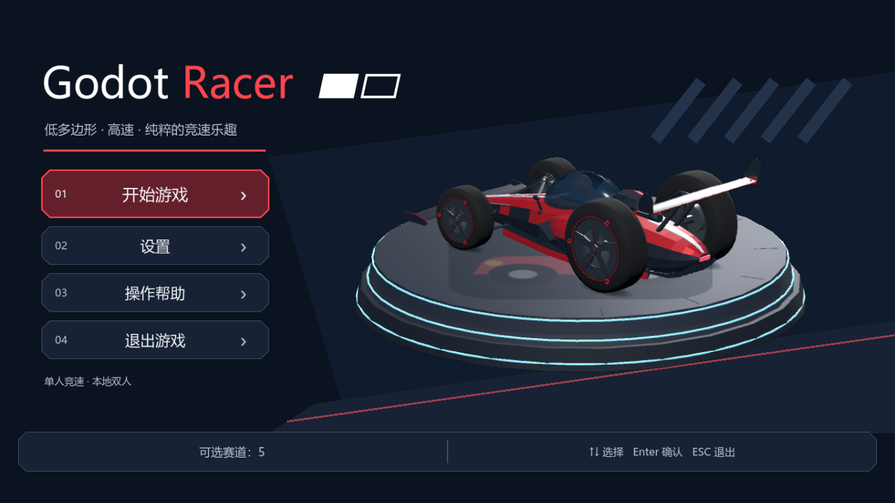

> **版本说明 · 2026-11-04**
>
> 本页展示 **Godot 4.7.2 Stable 本地开发候选**。GitHub 公开源码的运行基线为 **Godot 4.4.1**。这次更新同步 README、游戏截图和两版共用的展车渐显修复，下面按版本列出可用功能。

## 玩法

| 模式 | 开发候选的比赛规则 |
|---|---|
| 单人竞速 | 选任意赛道，完成两圈并记录整场成绩。AI 可在设置中开启或关闭。 |
| 无限练习 | 持续跑圈、熟悉路线，按赛道保留最佳单圈。 |
| 本地双人 | 同一台电脑左右分屏，共用键盘。入场后直接倒计时，先完赛的赛车立即停住，另一位玩家可继续比赛。双人赛有独立结算。 |

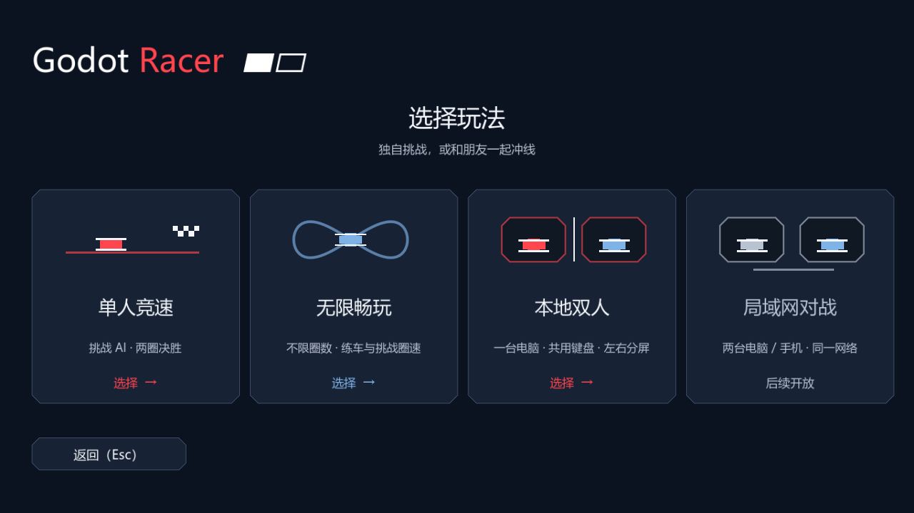

从首页选择「开始游戏」，再选玩法和赛道。赛道选择页可查看个人纪录并调整速度上限。单人普通比赛按赛道记录完成进度。个人最佳幽灵回放有效的驾驶轨迹，近距离冲线时可播放终点摄影。

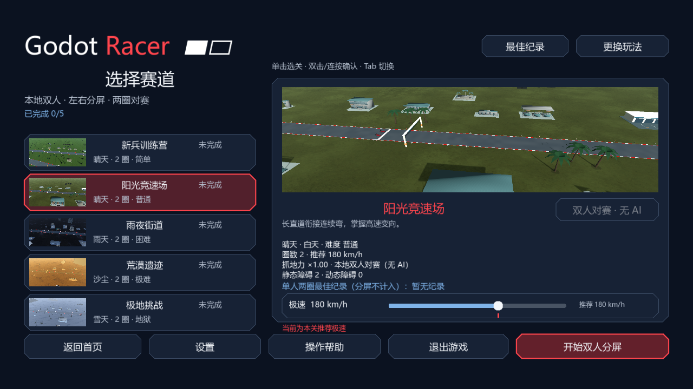

## 五条主题赛道

| 赛道 | 路宽 | 驾驶重点 |
|---|---:|---|
| 新兵训练营 | 18 m | 熟悉转向、起伏与入弯节奏 |
| 阳光竞速场 | 16 m | 直道加速与弯前制动 |
| 雨夜街道 | 15 m | 湿地抓地、夜间视野与避障 |
| 荒漠遗迹 | 14 m | 障碍之间的空间判断 |
| 极地挑战 | 13 m | 低抓地组合弯与速度控制 |

| 新兵训练营 | 阳光竞速场 |
|---|---|
| 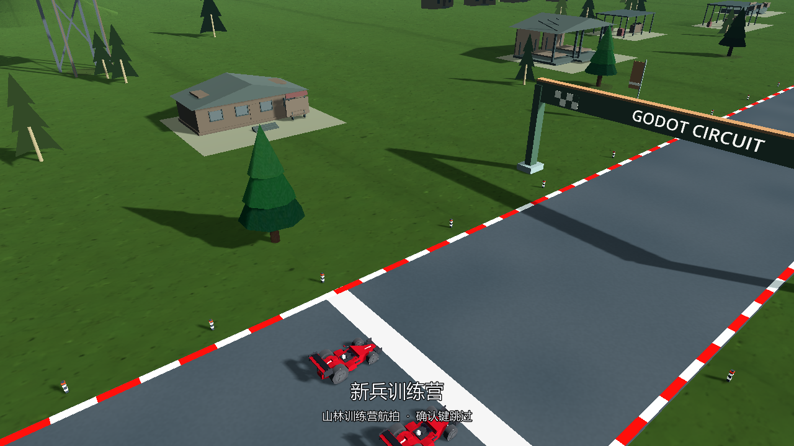 | 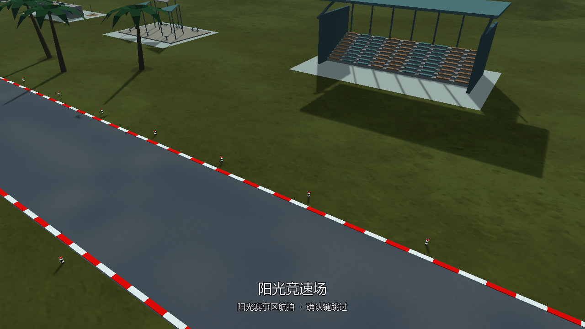 |
| **雨夜街道** | **荒漠遗迹** |
| 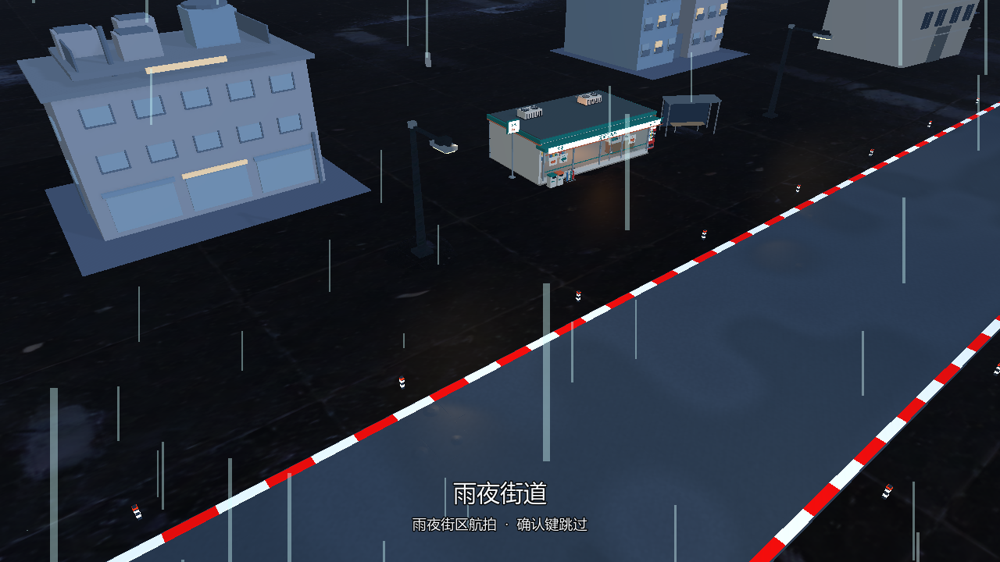 | 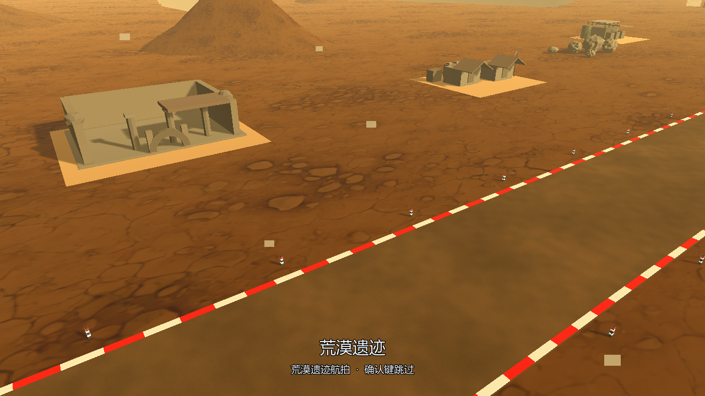 |

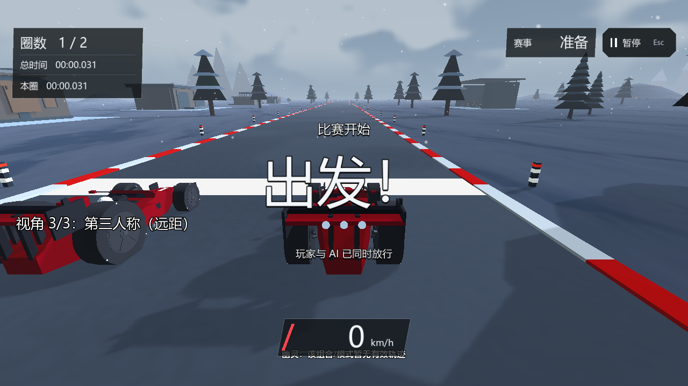

## 键盘操作

以下是开发候选的默认键位。进入首页「操作帮助」，选择单人或本地双人标签，点击漂移键即可改键。单人与 P1 共用一套漂移键，P2 可单独设置。冲突的键位会提示原因，保存的键位在重启后恢复。

| 操作 | 单人 / P1 | P2 |
|---|---|---|
| 加速 / 制动与倒车 | W / S | ↑ / ↓ |
| 转向 | A / D | ← / → |
| 手刹 | 空格 | 右 Ctrl |
| 漂移（按住） | 左 Shift | 主键盘 / |
| 后视（按住） | C | 右 Shift |
| 切换视角 | V | Enter |
| 车辆复位 | R | Backspace |
| 暂停 | Esc | Esc（暂停双方） |

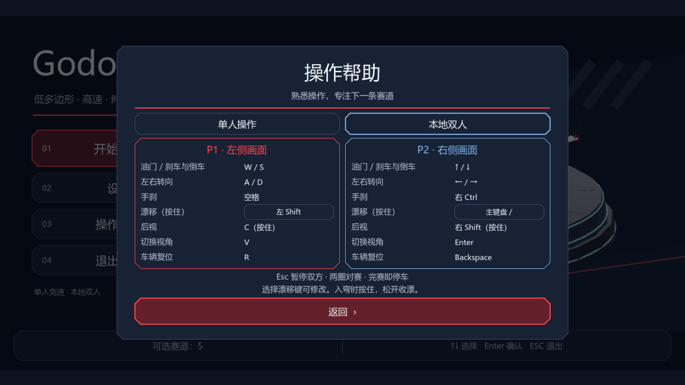

过弯时按住漂移键进入侧滑，适时反打方向可修正角度。复位会把车送回附近安全位置。分屏中，逆向提示显示在对应玩家的画面内，暂停菜单可以重看双方键位。

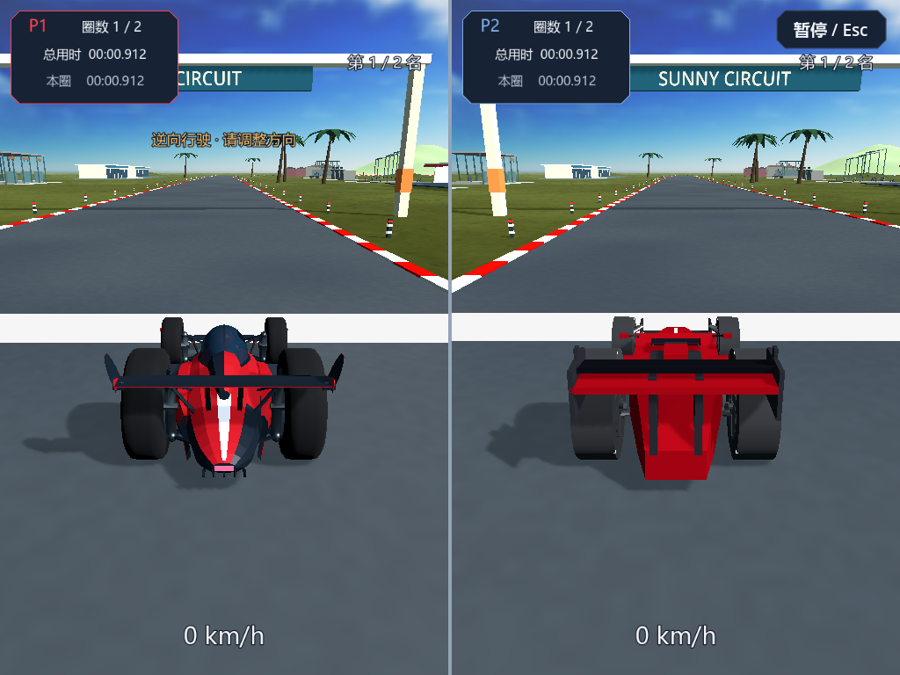

## 语言与声音

「设置」可切换简体中文、繁体中文、English、Русский、日本語、한국어，也可跟随系统。设置随游戏保存。六种语言覆盖首页、玩法、选关、操作帮助和主要比赛界面，仍在补查各比赛状态和窄窗口布局。

「设置 → 背景音乐」统一控制菜单和比赛 BGM。分屏中两台赛车都有引擎反馈。比赛音乐下调了音量，碰撞音按冲击强度变化，隐藏检查点已静音。

| 俄语设置 | 日语设置 |
|---|---|
| 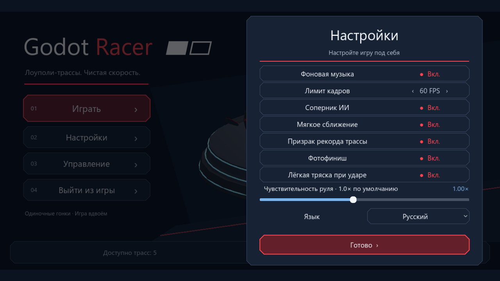 | 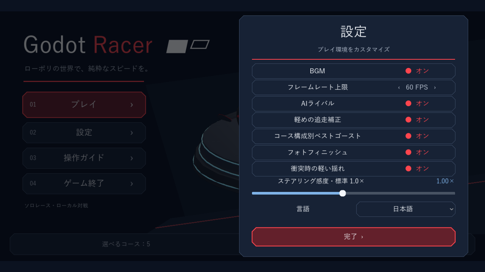 |

## 公开源码与开发候选

| 内容 | GitHub 公开源码 | 本地开发候选 |
|---|---|---|
| 引擎版本 | Godot 4.4.1 | Godot 4.7.2 Stable |
| 五关、驾驶、天气、AI、暂停与结算 | 已有 | 已有 |
| 单人两圈、无限练习、分关纪录 | 已有 | 已有 |
| 新首页、玩法选择、驾驶 HUD、五关完成进度 | 早期界面 | 已实现 |
| 个人最佳幽灵、终点摄影、轻度动态追赶 | 待同步 | 已实现 |
| 本地双人、漂移改键、六语言界面 | 待同步 | 已实现主要流程，仍在验收 |
| 网络联机、Android | 规划中 | 规划中 |

本地候选的 L2 分屏做过定向检查，包括双引擎混音、单侧逆向提示、完赛即停车和另一方继续驾驶。真实双人两圈、键盘组合、听感和持续漂移手感仍待试玩。部分本地布景和第三方模型未纳入公开源码，公开版实景会与本页截图有所不同。

## 从公开源码运行

1. 克隆 [QieRong/godot-racer](https://github.com/QieRong/godot-racer)。
2. 使用 **Godot 4.4.1 标准版**导入 `godot-racer/project.godot`。
3. 等待资源导入完成，运行主场景。两套工程均采用 **Compatibility、Jolt、120 Hz 物理更新**。

```powershell
git clone https://github.com/QieRong/godot-racer.git
cd godot-racer
& 'C:\Tools\Godot\godot.exe' --path .\godot-racer
```

将示例中的可执行文件替换为本机的 Godot 4.4.1 路径。使用本地 4.7.2 迁移候选时，从迁移目录的 `04-Godot启动器/运行游戏.bat` 启动，或用 4.7.2 打开候选工程的 `project.godot`。

## 下一步

1. 在阳光竞速场真人分屏跑完两圈，确认双方引擎和 BGM、碰撞反馈、持续漂移的角度控制，以及先冲线一方立即停车。
2. 按真实比赛流程补查六语言文案、字形和窄窗口布局，先处理试玩暴露的问题。
3. L2 验收后再扩展赛道美化。Android 和网络联机后续推进。

## 许可与文档

项目自有代码与文档采用 [MIT License](LICENSE)。第三方资源分别适用其许可。来源与使用范围见[第三方素材说明](THIRD_PARTY_NOTICES.md)和[第三方许可](THIRD-PARTY-LICENSES.md)。

[测试说明](godot-racer/docs/testing.md) · [工程笔记](godot-racer/docs/engineering-notes.md) · [设计说明](godot-racer/docs/portfolio-design.md) · [作者 QieRong](https://github.com/QieRong)
