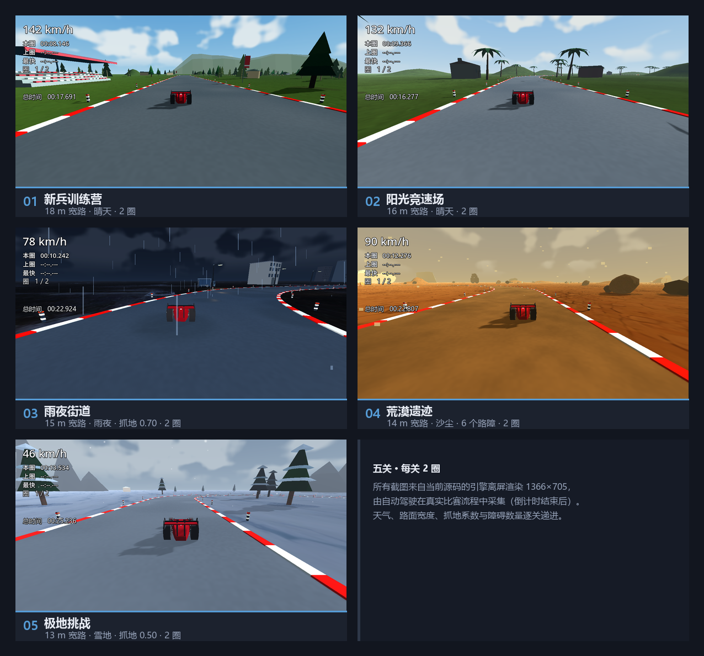
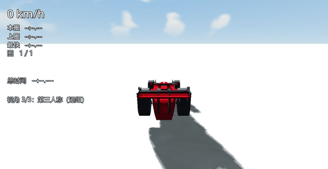

# Godot Racer｜五关单人 3D 赛车原型

**Godot 4.4.1** · 5 条主题赛道 × 每关 2 圈 · 单机 · 键盘驾驶 · AI 对手可开关

先在 18 m 宽的晴天赛道上学会转向、坡道与刹车节奏，再依次进入阳光竞速场、雨夜街道、荒漠遗迹与极地挑战：路面一路收窄到 13 m，天气从晴天走到雨夜、沙尘与积雪，抓地系数最低降到 0.50。项目重点不是堆素材，而是**规则怎么设计、难度怎么递进、界面怎么取舍**，以及每一次试玩反馈如何落回代码。


*首页：空展台升起后渐显的展车，左侧为主菜单（开始游戏 / 设置 / 操作帮助 / 退出游戏 / 背景音乐）。展车可用左键拖动环视。*

## 五关一览

项目包含 **5 个关卡**，共用同一套物理与计圈内核，差异全部来自关卡配置：路面宽度、天气、抓地、起伏与障碍数量逐关递进。



*五张截图均为当前源码的引擎离屏渲染（1366×705），由自动驾驶在真实比赛流程中采集：倒计时结束后开始行驶，非摆拍、非修图。*

| # | 关卡 | 路面 | 天气 / 抓地 | 静态障碍 | 这一关想让你练什么 |
|---|---|---|---|---:|---|
| 01 | 新兵训练营 | 18 m 宽沥青，Indy 结构改编 | 晴天 / 1.00 | 0 | 转向、坡道与刹车节奏，先把路线记住 |
| 02 | 阳光竞速场 | 16 m 宽沥青，Snetterton 200 改编 | 晴天 / 1.00 | 0 | 长直道全力加速，弯前提前收油 |
| 03 | 雨夜街道 | 15 m 湿沥青，Fosters 改编 | 雨夜 / 0.70 | 3 岩石 | 低抓地下的提前制动与绕障 |
| 04 | 荒漠遗迹 | 14 m 砂砾，Big Willow 改编 | 沙尘 / 1.00 | 6 路障 | 连续障碍下的路线规划 |
| 05 | 极地挑战 | 13 m 压雪，Hungaroring 改编 | 雪地 / 0.50 | 4 岩石 | 组合弯里的速度取舍与安全距离 |

路面起伏逐关加高（6/9/12 m → 8/12/16 m）。普通比赛默认在每关 **3×3 有限组合**里随机抽坡度与障碍：重试保留同一套，回菜单重开则重抽；`--fixed-race` 可回到固定对照。

## 一段 10 秒实机演示



*第 2 关的自动驾驶片段：倒计时结束 → 起步 → 长直道加速 → 入弯前收油。由引擎 Movie Maker 逐帧录制后转成 GIF，因此没有音轨（不是音频故障）。*

## 怎么玩

1. 首页点「开始游戏」进入选关，单击赛道可看天气、圈数、障碍与推荐极速。
2. 双击赛道或点「开始比赛」，等 3、2、1 与「出发！」——**计时从 GO 开始**。
3. 按顺序通过检查点，完成 2 圈后进入结算页，可重试或返回首页。
4. 首页「设置」可切 AI 对手、60/120 FPS 与背景音乐；选关页可调最高速度。

| 操作 | 按键 |
|---|---|
| 加速 / 刹车与倒车 | W / S |
| 左右转向 | A / D |
| 手刹 | 空格 |
| 车辆复位（沿赛道最多回退 30 m） | R |
| 切换视角（含第三人称、车头外视角） | V |
| 按住向后看，松开恢复 | C |
| 拖动环视 | 鼠标右键 |
| 暂停 / 返回 / 退出确认 | ESC |

**关于复位**：R 优先回到最近记录的安全行驶点，最多沿当前赛道向后 30 m；没有合适历史点时只在范围内找空闲路面。复位会扶正车身、清零速度、朝向赛道前进方向，且**不增加圈数**。游玩界面已取消小地图，M 键不再绑定功能。

## 一局比赛围绕哪些决策展开

玩家要在直道加速、入弯前减速、为障碍留出路线，并判断该不该用复位。同样的油门、刹车与转向，在不同天气和路宽下风险完全不同；最高速度是可调的取舍，而不是必须踩满的目标。

开启 AI 时，玩家与对手在倒计时结束后**同步获得驾驶许可**（同一入口发车，不存在抢跑）；关闭 AI 则进入练习模式，不把单人完赛包装成击败对手。成绩区展示总时间、末圈与最快圈，个人最佳按关卡持久保存，方便比较下一次尝试。逆行与复位反馈用于解释错误；计圈按实际检查点与压线规则判定。

## 当前状态与限制

源码已有五关、键盘驾驶、可开关的 AI、天气、障碍、暂停、结算与菜单音乐。下表是 2026-10-28/29 的专项结果，每项绑定当时的源码与原始记录，**不能合并成对整个项目的验收**：

| 专项 | 结果 |
|---|---|
| 五关边界、红白路缘、桩体位置及无新增碰撞 | 真实渲染 25/0；改前后路面/空气墙碰撞哈希与路宽一致 |
| 五关装配、发车及返回菜单 | 16/0，有真实截图 |
| 雨夜四灯照明、方向、镜像、随车更新与释放 | Compatibility 9/0，720p/1080p 截图已检查 |
| L1 贴墙专项 | 12/12（修正验收包围盒投影误差，未改物理与阈值） |
| 完整 lint、生产脚本解析、两道文档闸门 | 通过 |
| 雨夜天气步频 | Compatibility 约 119.8 Hz，过线；Forward+ 约 116.5 Hz，未过 |
| 雪地天气步频 | Compatibility 约 116.2 Hz，未过，待定位差异 |

**尚未完成**：主观驾驶手感与音乐听感的真人验收、导出包完整通关、干净 Windows 首启、最终源码的 AI 双帧率 18 次矩阵。自动截图与录像不能代替真人试玩，因此本文不宣称「整项目全绿」。历史性能与机器检查绑定各自版本，详见[测试说明](godot-racer/docs/testing.md)。

尚未提供手柄、多人和完整商业化内容。

## 运行方式

用 Godot 4.4.1 标准 Windows 版打开 `godot-racer/project.godot`，或双击 `04-Godot启动器/运行游戏.bat`（带窗口、含音频）。命令行等价写法：

```powershell
& 'E:\godot\Godot_v4.4.1-stable_win64.exe' --path .\godot-racer --rendering-method gl_compatibility
```

- 默认 Compatibility；`--rendering-method forward_plus` 可手动切到 Forward+（其雨夜步频仍未过线）。
- `--race-variants` 进入 L2 随机试验入口；`--fixed-race` 回到固定坡度与静态障碍。
- `--shot` 族与 `--check=<名>` 是自动化验收入口，见下。

相关验证入口（标签须换新名以保留历史证据）：

```powershell
python godot-racer/tests/run-minimap-removed.py NEW_TAG --graphics
python godot-racer/tests/run-showcase-delivery.py matrix NEW_LAYOUT_TAG
pwsh -File .\04-Godot启动器\check-readme.ps1
pwsh -File .\04-Godot启动器\check-docs.ps1
```

底层诊断入口按职责保留：场地与恢复 `enclosure`、`layout`、`reset`、`oob`、`escape`、`resetkey`、`wallslide`、`flip`；对手与避障 `opponents`、`avoid`、`obstacles`、`aistart`、`aidiag`；驾驶与流程 `phys`、`weather`、`friction`、`steerbench`、`brakebench`、`stress`、`stuck`、`lap`、`reverse`、`pause`。已取消的小地图实现、HUD 辅助与对应生产检查入口在 2026-10-29 彻底删除，防回归检查仅留在 tests 中。

## 素材来源与许可

自有代码与文档采用 [MIT 许可](LICENSE)。外部组件与素材的完整清单见[第三方说明](THIRD_PARTY_NOTICES.md)与[随包许可](THIRD-PARTY-LICENSES.md)。

### 音效

| 来源 | 内容 | 许可情况 |
|---|---|---|
| [Mixkit](https://mixkit.co/)（Envato 旗下，澳大利亚） | 30 个音效：引擎启动与各转速循环、换挡、碰撞与撞击、界面悬停/点击/返回/错误、倒计时与检查点、单圈与胜利、风与自然环境 | *Sound Effects Free License*：**可商用、明确允许用于电子游戏、不要求署名**；**不得把音效作为独立素材再分发**（上传素材站、做成声音包分发） |
| [SoundDino](https://sounddino.com/) | 雨声循环 `rain_loop.ogg`（雨夜关卡环境声） | 站点声明免费使用、可商用、不强制署名 |
| 本项目自研合成 | 轮胎啸叫、轮胎尖叫、速度风噪；结算失败音由胜利音变调派生 | 随项目按 MIT 发布 |

**来源核查说明**：逐条核对过 `assets/audio/source-manifest.json`、素材说明与源码引用，项目中**没有任何日本音效素材站的来源记录**（魔王魂、効果音ラボ、音人、OtoLogic 等均无痕迹，也无 `.jp` 域名引用）；实际来源即上表。

**结论**：音效**可以商用**，但并非「完全无限制」——Mixkit 条款禁止把音效当素材再分发。因此把原始 wav/ogg 直接放进公开仓库，与该条款存在张力；把它打包进可执行游戏分发不受此限。若后续要开源整包素材，建议只保留游戏所需的转码产物并复核条款。

## 更多文档

[当前状态与未通过项](godot-racer/docs/current-status.md) · [测试与证据](godot-racer/docs/testing.md) · [工程笔记](godot-racer/docs/engineering-notes.md) · [设计说明](godot-racer/docs/portfolio-design.md) · [导出链路](godot-racer/docs/release-export.md) · [开发契约](godot-racer/AGENTS.md)
