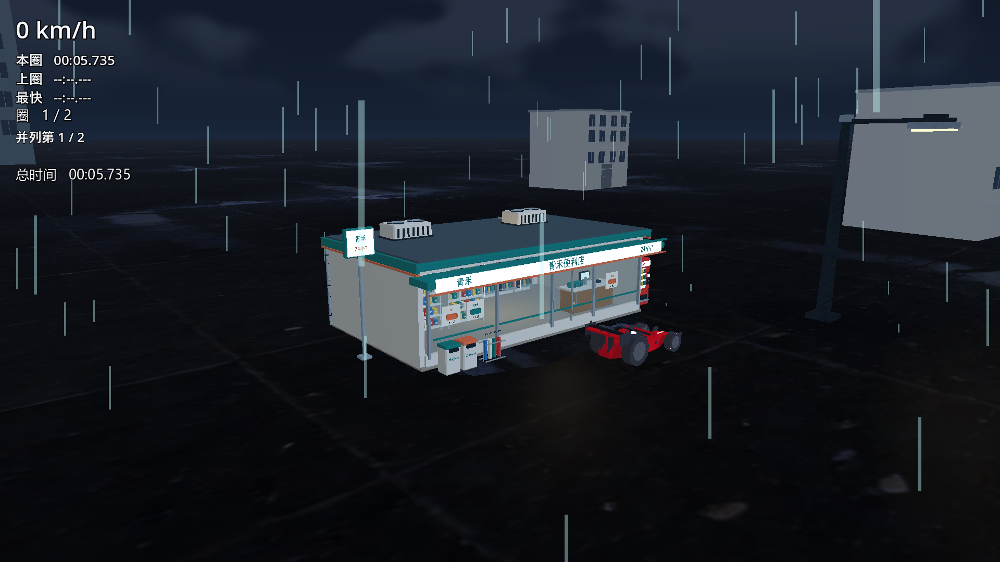
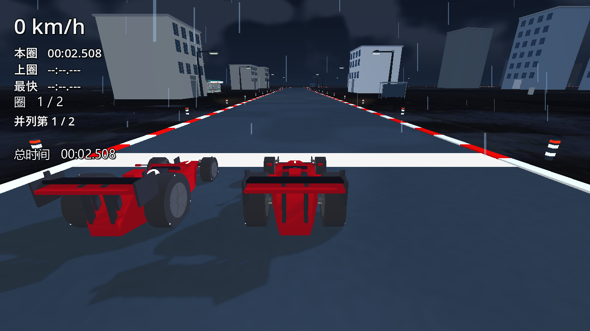

# 当前状态

更新日期：2026-10-28。这里集中记录现状，不再提交逐轮计划、交接和测试流水账。

## 公开范围与使用

GitHub公开最新游戏代码、必要配置/测试、说明和PNG图片。新增GLB、Blender工程、模型库和建模脚本仅保留本地；本次提交不携带它们。既有公开历史中的旧模型不作历史改写。

用Godot 4.4.1打开工程的project.godot。公开版本缺少可选私有模型时会跳过相应装饰，保留车辆、道路、天气和已有基础布景；它不会呈现本地候选的全部美术。美术专项需要私有模型，不能用缺资源的公开工程冒充完整美术验收。

## 已实现

五关独立布景/天空、灰蓝雪道、白色起点线、红白路缘及约11.75m间距反光柱；雨夜建筑正面朝路、左侧近中景错落。L2三乘三受约束组合已接入试验入口，其余四关尚未推广随机化。

本地中文青禾便利店含真实门窗、货架商品、收银台、冷柜、售货机、伞架、垃圾箱和屋顶设备；三间沿圈稀疏错位，左二右一，最小间隔约764m。店内/檐下两盏近车暖灯由三店共用，无新增实时阴影；已有地面接收局部光照，700粒雨丝逐顶点受光。便利店主体及附属物不包含周围道路或独立地台。用户决定方向与体验验收，AI辅助程序和建模。

## 验证与边界

本地含私有美术的候选：便利店资产9/0、正常雨夜与室内照明32/0（室内灯开关22570像素亮度响应）、反光10/0、路面26/0、路灯10/0、雪地13/0、五关布景69/0、边界闭环15/0。公开副本另做导入、lint/parse、缺私有美术装配与文档检查；其结果不等同于私有模型专项。

雨夜最终天气步频115.8Hz、雪地116.6Hz均低于原118Hz门槛，各有3项失败断言。早前雨夜单次120.2Hz不能覆盖最终失败。物理步频不代表持续渲染FPS。

天空GL纹理退出释放、证书读取错误及Forward+历史退出超时未闭环。真人体验U、L2最终18次双档矩阵/剩余玩家验证、必要全量/AC-13、稳定性与外机验收仍待继续。旧AI1686行债务未改，新改GD均不超过1000行。未重冻、未导出新EXE/ZIP、未创建Release。

## 本地候选实际截图

以下PNG展示含私有模型的本地候选，公开源码不携带图中的新增GLB，不能当作公开工程默认画面或真人U验收。

