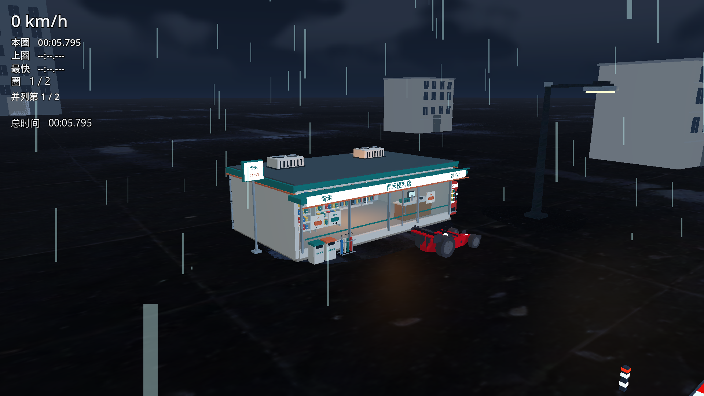
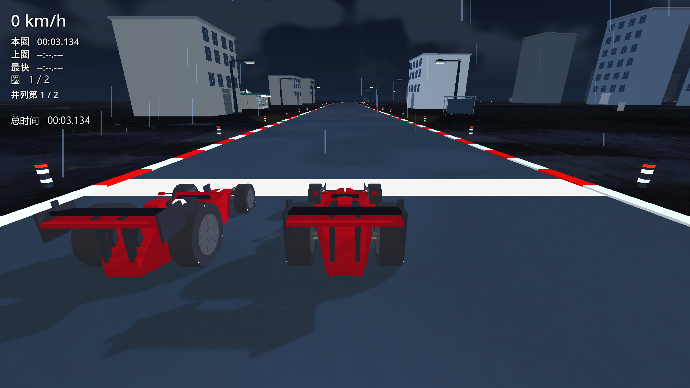
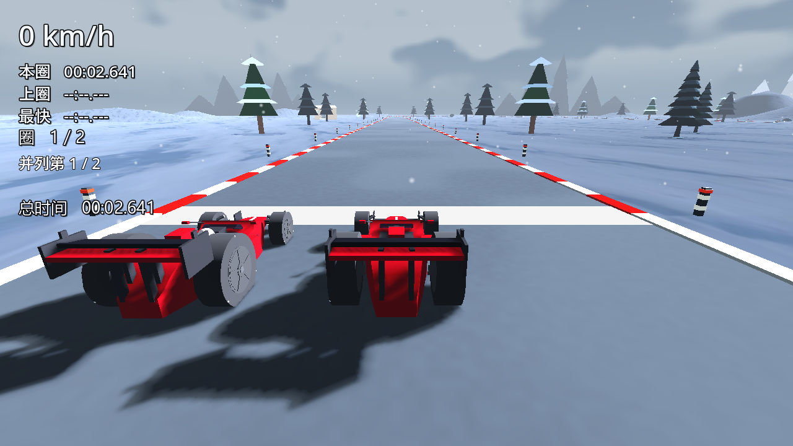

# 当前状态

更新日期：2026-10-28。这里集中记录现状，不提交逐轮计划、交接和原始测试流水账。

## 公开范围与使用

公开代码、必要配置/测试、说明和PNG；新增GLB、Blender工程、模型库及建模脚本只留本地，既有公开历史不改写。Godot 4.4.1打开project.godot；缺可选私有模型时跳过对应装饰，公开工程不呈现完整本地美术。原始日志和私有资产均未上传。

## 已实现与用户反馈

五关独立布景/天空、灰蓝雪道、白色起点线、红白路缘和约11.75m间距反光柱。用户看过雨夜黄白小样后选择保留红白。L2有3种坡度剖面×3种障碍布局的有限试验组合，其他四关尚未推广随机化；重试保留本局组合，返回菜单后可重新抽取。

路缘和反光柱从最终3D中心线/边界取位；边上建筑、树木等采样路肩到外部地面的高度过渡，并做道路净空检查，不添加装饰碰撞。不是把平地摆放直接搬到坡道上；逐组合及真人视觉验收仍须独立完成。

本地青禾便利店包含门窗、货架商品、收银台、冷柜、售货机、伞架、垃圾箱和屋顶设备。按用户选择改为9间路边店，左五右四、门面朝赛道，最小沿圈间隔约252.1m，保留模型半径和5m道路/护栏净空。主体及附属物不含周围道路、停车场或独立地台。

9店共用两盏近车暖灯，无新增实时阴影；用户已确认保留增强后的暖光强度，真人驾驶体验仍待确认。室内受光区暖色覆盖约39.1%，接近过曝1像素；700粒雨丝与原速度保留。仍为16个便利店材质批次，按450m距离筛选绘制实例；九店原始变换保留，靠近后恢复。

## 本轮验证与实际边界

含私有美术的九店/朝向/净空/真实照地/暖光专项37通过、0失败；实例可见性与移近恢复专项通过。既有资产9/0、反光10/0、路面26/0、路灯10/0、雪地13/0和五关布景69/0属于先前对应源码的专项，不能代替本轮全量。当前五关装配发车及返回菜单16/0；lint/parse通过。公开副本另验证缺资产回退，不等同于完整美术验收。

定位到车辆诊断逐行输出阻塞：保留同机180行报告内容，将单次中位耗时从19.01ms降至2.22ms。原天气118Hz门槛未变。九店未筛选实例时116.5Hz的失败保留；最终九店雨夜60/120/60目标档依次120.0/120.2/119.6Hz，通过原门槛。雪地本轮60/120/60目标档为120.1/119.8/119.9Hz。物理步频不代表持续渲染FPS，尤其不能宣称本机已持续达到120FPS。

环境浅复制与旧天空延迟到本帧渲染结束后释放，覆盖临时深复制Sky和首帧前占位天空两条泄漏路径；最小红/绿例、完整便利店及五关装配退出均未再出现GL纹理泄漏。证书读取错误仍在。Forward+雨夜119.7Hz且正常退出；Forward+雪地虽测得120.0Hz，退出仍140秒超时，因此该项失败并未闭环。

L2最终18场真实渲染双档矩阵按用户要求安排本地后台串行执行，未取得最终结果前不计通过；首个失败停止，不自动重试、不重冻。剩余玩家验证、真人U、必要全量/AC-13、稳定性与外机验收仍待继续。旧AI1686行债务未改，新改GD均不超过1000行。未导出EXE/ZIP、未创建Release。

## 本地候选实际截图

图片来自含私有模型的本地候选，不是公开工程默认画面或真人U证据。

