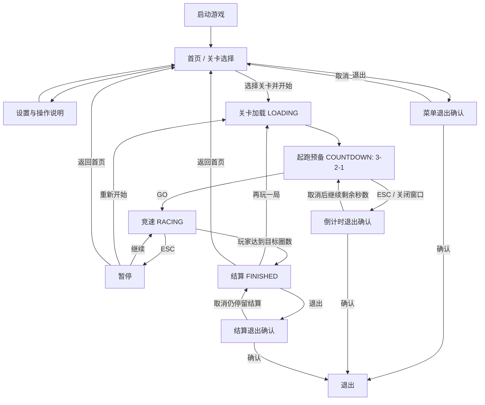

# Godot Racer｜游戏策划面试作品集完整开发规划（执行版）

> **版本**：v1.0 / 2026-10-19  
> **用途**：作为后续每轮 AI 协作、Godot 开发、人工试玩及策划作品集交付的总纲。  
> **项目**：[QieRong/godot-racer](https://github.com/QieRong/godot-racer)  
> **远端核对基线**：`7f65173685bfbd1fc6aeacd5c5405a7cb85992c3`（2026-10-19；远端 main 查询结果）。  
> **资料来源**：用户提供的 `handoff-interview-20261019.md`、旧版 `racing-system-design-20261018.md`；远端最新版 `menu.gd`、`start_countdown.gd`、`finish_menu.gd`、`hud.gd`、`race_position.gd`、`game_state.gd`、`main.gd`、五关 `.tres`、`AGENTS.md`、`README.md`、`portfolio-design.md`、`testing.md`、`tracks-and-elevation.md`。  
> **重要限制**：本文件是**审查与执行规划**，不是实机验收报告。本轮没有运行 Godot、没有在用户电脑上试用首页和结算，也没有修改 GitHub 仓库。用户明确反馈「倒计时、结算、游戏首页等尚不完整」，必须作为待解决的产品缺口，而非被现有测试或代码存在所否定。  
> **存放建议**：用户确认后在仓库中新增 `plan/interview-portfolio-master-roadmap-20261019.md`；本文件只是可下载的工作文档，尚未写入 GitHub。

---

## 0. 先统一目标：做一份能让游戏策划面试官看懂、玩懂、追问的作品

**项目定位**：Godot 4.4.1 单机 3D 赛车策划原型，5 个主题关卡、1 台默认 AI 对手、天气与抓地力、障碍、计圈与竞速。它不是商业发行项目，近期也不是底层物理引擎研究项目。

**求职能力目标**：

1. **系统策划**：能说清菜单—选关—加载—倒计时—比赛—暂停—结算—重试的完整规则、UI、边界和异常处理。
2. **关卡策划**：能说明五关各自教什么、考什么、为什么难度变化，以及实际赛道如何支撑这些目标。
3. **数值策划**：能利用 Excel 管理配置、建立调整假设、记录 A/B 和测试结果，而非随意改倍率。
4. **协作与验收**：能把规则写成程序/美术/测试可执行的需求，保存配置变更、截图、视频和修复记录。
5. **真实贡献**：如实注明「个人提出目标/设计规则/制定难度/决定取舍/审核 AI 辅助实现/组织测试」，不把 AI 编写的代码描述为独立手写。

**项目原则**：「可运行」不是「可交付」；「代码存在」不是「功能完整」；「自动化通过」不是「玩家觉得好用」。

**暂不追求**：联网、多人竞技、商城/付费、复杂剧情、增加大量车辆、主动超车 AI、整体物理重构、一次性重做五关/全部美术、为面试凑数的战斗系统。

---

## 1. 状态口径与正式完成标准

### 1.1 三维完成状态（以后所有交接都用）

| 维度 | 含义 | 判定所需证据 |
|---|---|---|
| **C：代码状态** | 仓库已有对应功能或文件 | 当前 commit + 代码入口/差异 |
| **T：测试状态** | 新需求下机器测试、集成回归按原判据通过 | 日志、最终 PASS、退出码、版本、运行环境 |
| **U：体验状态** | 用户本人从菜单到结算完整试玩，视觉、交互、反馈达到约定效果 | 实机截图/短视频、手动测试记录、缺陷关闭证明 |

**完成功能 = C/T/U 均通过。** C 已实现但 U 未确认，标签统一写 **「已有代码·待体验验收」**；不得写「功能已经完整」。

此外，体验验收分为 **阻断缺陷**（无法开始、计时错误、AI 抢跑、结算不可操作、卡死）、**严重缺陷**（文字遮挡、错位、名次显示错、重开不重置）、**一般问题**（样式普通、音效欠缺、反馈不够明显）。阻断缺陷未清零，不能进入面试演示冻结。

### 1.2 核对基线的已知状态

| 系统 | 代码层面的证据 | 当下应采用的工作标签 |
|---|---|---|
| 游戏首页/选关 | `menu.gd`：深色纯背景、居中面板、五关按钮、速度滑条、AI 与帧率开关；缺少独立的完整首页视觉/信息结构 | **已有基础 UI，完整性不通过用户主观验收** |
| 倒计时 | `start_countdown.gd`：3/2/1/出发、3 秒计时、0.5 秒 GO 保留、退出确认冻结机制 | **已有逻辑，动效/声效/镜头/UI/真实发车体验待验收** |
| 同步发车 | `main.gd::_on_race_go`：玩家解锁、AI `arm_opponents()`、`start_race()` | **已有逻辑，必须实机核验同帧表现和按住 W 的情况** |
| 比赛 HUD | `hud.gd`：速度、圈数、圈速、总时间、小地图；`race_position.gd`：名次、AI 完赛提示 | **已有基础，层级/拥挤/多分辨率/提示待完善** |
| 计圈/总时间 | 2026-10-19 第四轮实现 GO 同原点；文档宣称总时间约等于完整圈时之和 | **新修改已提交，提交后验收及用户试玩尚待完成** |
| 结算页 | `finish_menu.gd`：名次、冠军文案、总时间、末圈/最快圈、双方成绩表、三个按钮 | **已有文本化页面，视觉完整度与胜败情境待验收** |
| 起点龙门架 | `start_gantry.gd` 已接入主场景；交接记录有 L1 柱体偏厚问题 | **已实现，模型尺寸与真实观感待决定** |
| AI 竞速 | 默认每关 1 台；避障、完赛、车辆碰撞逻辑已具备 | **保留既有物理/AI基线，测试及玩家主观公平性仍需确认** |
| 赛道几何 | 当前五关 `.tres` 使用 `ellipse` / 带正弦扰动的 `ellipse`；路段 DSL 基础已存在 | **路线差异化尚未达到策划目标** |
| 音频 | 雨声和占位引擎声已有；交接记载 2 个音频测试既存失败 | **音效系统未完成；缺陷独立列账** |
| Excel 配置 | `.tres` 已有可编辑数值；交接提到 Excel 规划文件但远端 `plan/` 暂未找到 | **不认定 Excel 管线已经建成；需先核本地文件** |
| 实体 Windows 包 | 已有导出链与既往测试记录 | **当前新版本导出包、干净机器和完整操作路径仍需复核** |
| 作品集证据 | `portfolio-design.md`、系统策划案、测试文档存在 | **资料基础良好，但缺少完整 UI 成品及真实玩家反馈** |

**特别提醒**：上传的旧 `racing-system-design-20261018.md` 是 v1.0，其「倒计时尚未实现」只描述旧提交 `4cfb6a6`；远端策划案已更新到 v1.2，代码已落地。不能把旧计划缺口重新当成尚无代码，也不能因为代码有了就忽略现在的视觉/交互缺口。

### 1.3 与现有交接文档的关系

- **先承接已批准的第四轮测试**：冻结带重冻结、`aidiag`、Quick 15、全量 20、双帧率缩减回归、用户本人试玩、L1 龙门架观感裁决。
- 不推翻现有 R6/R15 「GO 同原点」决策；若再次改计时口径，必须先提出反例及用户批准。
- 不移除既有 2 个音频失败，也不把它们混同为本轮回归引起；同时记录其实际用户影响。
- 任何代码变更都遵守 `godot-racer/AGENTS.md`，特别是 TDD、保护几何/车辆/AI 公式、保留原断言和显式 Git 批准。

---

## 2. 目标版本与交付范围

### V0.9：**完整面试试玩闭环**（第一优先级）

玩家不看源码、不靠开发人员现场解释，可以：

**启动 → 看到像游戏的首页 → 选关/看规则 → 开始 → 看清起跑与倒计时 → 和 AI 正常比赛 → 看到清楚的名次/圈数/速度 → 完赛 → 一眼看懂赢/输及成绩 → 再玩一局或返回首页。**

**完成条件**：

- 五关能从首页进入且都能走完正常流程；至少 L1、L3、L5 覆盖真实录像与结果。
- 首页/倒计时/HUD/结算四处 **没有阻断或严重 UX 缺陷**。
- 练习（AI 关）与竞速（AI 开）均可正常开赛、完赛、结算和重开。
- 使用 1280×720 基准视口录屏；增加一档较大分辨率复核，不出现关键元素被遮挡或挤出。
- 关键机器回归通过；未通过项有明确例外/风险登记，不能模糊宣称“全部通过”。
- 一份可从头到尾播放的 2—3 分钟演示视频初版。

### V1.0：**关卡/数值策划作品集**（第二优先级）

在 V0.9 稳定的前提下：补齐五关教学目标与路线差异、Excel 配置表、参数调整记录、真实玩家试玩反馈，并形成正式的 GDD、系统策划案、关卡设计文档和作品集说明。

### V1.1：**可选体验增量**

美术风格统一、声音丰富、更多路边环境物件、小幅镜头打磨、进一步赛道形态与地形演出。可选项要以玩家反馈确定，不作为 V0.9 发布阻断。

---

## 3. 用户主流程与异常分支（所有模块共享的规则）



**共享原则**：

1. LOADING 尚未装好赛道/AI 不能提前显示倒计时；GO 之前车不能主动移动。
2. **GO 只发生一次**；玩家与 AI 统一发车入口；GO 瞬间开始互动模式的计时，不能出现 HUD 晚一拍或开始前累积时间。
3. **只由玩家完赛终止本局**（现有设计）；AI 先完赛记录结果但不踢玩家出局。AI 完赛后不应继续物理阻碍玩家。
4. 结算只快照一次；下层赛场冻结；ESC、重开和退出须遵守状态机。
5. 「关闭 AI」视为练习模式，不能显示虚假的 1/1 冠军名次。
6. 显示必须基于同一个事实来源；不要为动画、UI 或测试再写一份成绩/排名算法。

---

## 4. 迭代阶段与逐项工作包（核心）

**执行顺序建议：M0 → M1 → M2 → M3 → M4 → M5 → M6 → M7 → M8。** 同一阶段一次只推进一个最小、可验收工作包；不要让 AI 一次性重写 `menu.gd`、`main.gd`、`vehicle.gd` 与 `finish_menu.gd`。

### M0｜建立体验缺陷基线与保护已有功能（P0）

**目标**：首次用「真实玩家视角」建立待办，而非只看代码。

| ID | 任务 | 输出/通过标准 |
|---|---|---|
| M0-01 | 核对本地 HEAD、远端 main、`git status` 和用户尚未上传的 plan/资产 | 基线记录；不触碰用户未跟踪文件或素材 |
| M0-02 | 接续第四轮 D2 验证：冻结带→aidiag→Quick→全量→缩减双帧率 | 逐项日志、PASS/FAIL、退出码；不得为变绿降低阈值 |
| M0-03 | 人工从首页玩 L1/L3/L5，AI 开/关各有代表性场景 | 首页、倒计时、比赛 HUD、结算和重开至少各 1 张**实机截图** + 1 段流程录像 |
| M0-04 | 建缺陷登记表：问题编号、发生阶段、重现步骤、期望/实际、严重性、版本、截图 | 阻断/严重/一般分级；记录「你觉得不完整」具体是少功能、难用还是观感差 |
| M0-05 | 核查 2 个既存音频失败与 L1 龙门架偏厚 | 明确玩家实际影响和下一步决定，保留对照测试 |

**阶段出口**：形成 `docs/ux-baseline-20261019.md`（建议路径；若有重名则换名）和一张按优先级排序的缺陷表。**没有基线截图，后续“体验变好了”的结论缺乏对照。**

### M1｜完整首页、选关及设置（P0；优先解决「首页不完整」）

**现状**：`menu.gd` 已有「Godot 赛车」标题、五关文字按钮、极速滑条、AI/帧率开关及操作文字，但属于功能列表式 UI。

**需要先产出的策划规格**：`docs/design/menu-ui-spec.md`，附一页静态排版草图。视觉方案经用户确认之后才能开发。

| ID | 任务 | 具体要求 | 验收（人工+机器） |
|---|---|---|---|
| M1-01 | 首页信息架构 | 清楚区分游戏标题、**开始游戏/选择关卡**、设置、操作说明、退出；不要把调试字段当核心卖点 | 首次用户 10 秒内能找到如何开始游戏 |
| M1-02 | 五关卡片或清晰选关区 | 每关：名称、主题、难度标签、**一句玩法挑战**、路宽/天气等关键区别；缩略图若尚未制作，使用经过审定的占位样式，不能假装实机图 | 五关信息可辨且文字不溢出；选择与启动没有误点 |
| M1-03 | 游戏设置 | 保留已真实支持的 AI 开关、建议/自定义车速、60/120 FPS。建议区分**标准推荐模式**与手动改极速，避免自定义极速与策划标准难度混淆 | 切换设置后实际比赛状态正确；不存在「设置显示值≠生效值」 |
| M1-04 | 操作说明 | 增加一屏可关闭的按键提示：WASD、空格、R、V、M、ESC、右键环视；不要塞满主屏 | 新用户不读 README 也能开车与重试 |
| M1-05 | 键鼠交互 | 鼠标点击、↑↓/Tab/Enter 导航、焦点高亮、ESC 返回或请求退出；进入设置后返回焦点合理 | 只用键盘和只用鼠标均可完成操作 |
| M1-06 | 视觉统一 | 确定主色、字体、按钮三态（普通/悬停/选中/禁用）、标题及留白；1280×720 下布局完整 | 没有焦点丢失、关卡卡片截断、内容压住屏幕边缘 |
| M1-07 | 错误与空状态 | 找不到关卡时显示清晰错误与返回入口；加载失败不黑屏、不卡住 | 失败有可理解文案；自动化的 `--level`/`--check` 入口继续工作 |
| M1-08 | 音量/全屏等可选设置 | 先确认现状；没有实际支持就不要放虚假开关。声音设置与新模块在 M5 做 | 不出现无效按钮或未实现功能冒充可用 |

**建议 1280×720 排版草图**：

```text
┌─────────────────────────────────────────────────────────┐
│  GODOT RACER                       设置  操作说明  退出 │
│  速度 · 路线 · 天气                                   │
│                                                         │
│  关卡列表                         选中关卡详情           │
│  ① 新兵训练营                    [实机预览/主题视觉]    │
│  ② 阳光竞速场                    任务：学习刹车点       │
│  ③ 雨夜街道                      天气：雨 / 目标：3圈   │
│  ④ 荒漠遗迹                      对手：开启 / 关闭       │
│  ⑤ 极地挑战                      极速：推荐 / 自定义    │
│                                  [ 开始比赛 ]           │
│                                                         │
│  WASD 操作 · ESC 返回          60/120 FPS（设置中）    │
└─────────────────────────────────────────────────────────┘
```

此图是**目标信息结构**，不是代码已实现的画面；实际布局先经原型与 720p 截图验证，再决定双栏或上下布局。

**阶段出口**：首页真实截图 + 键盘操作录像 + 菜单专项回归 + 一页菜单系统策划说明。

### M2｜补全加载—倒计时—同步发车的实际体验（P0）

**现状**：有 3 秒逻辑与 GO 回调，但视觉主要为居中 96px 纯文字；不能把「倒计时数字能显示」等同于「完整的起跑表现」。

| ID | 任务 | 具体要求 | 验收 |
|---|---|---|---|
| M2-01 | 起点镜头与位置 | 玩家车、AI、起终点线/龙门架能同时被正确理解；避免镜头被柱体遮挡 | L1~L5 各抓 1 张倒计时截图，关键信息完整 |
| M2-02 | 加载与预备状态 | 装配完成才显示 3；无黑屏误判或提前计时 | 每关首次进入/重开都正确 |
| M2-03 | 倒计时视觉层 | 3/2/1/GO 字体、颜色/比例变化、画面中心对比度、文字遮挡安全区；如加动画必须不改变发车时间 | 60/120 FPS 无跳号、闪烁或停留异常 |
| M2-04 | 灯/音效反馈 | 如引入起跑蜂鸣、倒计时提示，必须与状态机同源；音频资源合法并有音量控制 | 画面数字、声音、实际解锁的关系明确；静音也能理解 |
| M2-05 | 按键和暂停边界 | 倒计时期间按住 W、ESC 退出确认/取消、反复 ESC、窗口失焦、无 AI 情形 | GO 前不动、GO 后不吞输入；取消继续剩余倒计时 |
| M2-06 | 同步和计时 | 玩家/AI 下一物理帧可启动；GO 时本圈/总时间同原点，完赛后不漂移 | 专项测试 + 两档渲染 FPS + 人工录屏 |
| M2-07 | 龙门架质量 | L1 柱体偏厚和穿模/碰撞问题，调整素材前核实现有物理层与尺寸 | 站位/宽度正确，进门不撞、碰柱有合理反馈 |
| M2-08 | 重开 | 暂停重开和结算重开都重新加载→倒计时→GO；不保留旧局计时 | 连续重开 3 次没有多余倒计时 UI/旧 AI |

**禁止**：为做倒计时动效而修改车辆扭矩、转向公式、AI 目标速度或原有 3 秒判据。

**阶段出口**：L1/L5 各一段 10—15 秒起跑录像；倒计时策划规则对照表和专项测试证据。

### M3｜比赛 HUD、反馈与操作完整性（P0）

| ID | 任务 | 内容 | 验收 |
|---|---|---|---|
| M3-01 | 信息优先级 | 第一层：当前名次/目标圈数/车速；第二层：本圈/总时间/最快圈；第三层：小地图/警告 | 首次试玩者能立即找到当前位置与比赛目标 |
| M3-02 | HUD 布局 | 不同提示不遮挡速度、圈数、排名、视角信息；支持 1280×720 和更大分辨率 | 关键内容没有重叠/裁切 |
| M3-03 | 名次准确性 | 玩家超越/被超越、跨圈、复位、AI 先完赛、同帧事件处理清晰 | UI 排名和实际场景一致；不突然出现错误第一名 |
| M3-04 | 计时一致性 | GO 起表，总时间与完整圈速和逻辑吻合；暂停停止、结算冻结 | 截屏标明 GO/第一圈/末圈，数据解释得通 |
| M3-05 | 玩家反馈 | 错向提示、低抓地力提示、障碍可识别性；复位后明确恢复游戏目标 | 提示短、清楚、不挡道路 |
| M3-06 | 镜头与可控性 | 追尾视角、切镜头、右键环视的基本可读性；不要为了炫技造成眩晕 | 新用户能够识别车头方向和下一弯 |
| M3-07 | 暂停流程 | 继续、重开、回首页、退出确认；状态正确，计时与 AI 不偷跑 | 多次进入退出无状态残留 |
| M3-08 | 无 AI 练习 | HUD 不显示无意义的 1/1 排名，结算文案为练习成绩 | UI 不误导玩家 |

**阶段出口**：HUD 信息层级图，正常/错误方向/暂停/练习四类截图 + 手工检查表。

### M4｜完整结算页面、获胜反馈、重试闭环（P0）

**现状**：结算已经提供成绩字段，但主要通过 `PanelContainer + Label + Button` 拼装；需要按照实际游戏结果重新设计展示层级和交互。

**建议结算信息顺序**：

1. **结论**：「获得第 1 名 / 第 2 名」或「练习完成」，与真实判定一致；不要在失败时仍显示“你获得冠军”。
2. **关键成绩**：总时间（突出）、完成圈数、最佳圈速；末圈作为次要信息。
3. **比赛对比**：玩家与 AI 的位置、圈数、完赛/未完赛状态；若没有可信的 AI 完赛总时间，不要伪造差几秒。
4. **操作**：主按钮「再玩一局」，次按钮「返回主菜单」，退出放次要层，ESC 行为明确。

| ID | 任务 | 内容 | 验收 |
|---|---|---|---|
| M4-01 | 三种结算情景 | 玩家赢、玩家输、AI 关闭练习；文案及按钮逻辑分别设计 | 逐情景实机截图、语义无歧义 |
| M4-02 | 数据规则 | 结算使用 `GameState.finish_snapshot` 真值；与 HUD、名次同源 | 完赛后数值不继续增长、不变更 |
| M4-03 | 结果视觉层级 | 排名最醒目，成绩易读，玩家行有区别；考虑 720p 不溢出 | 无「数据很多却看不清主结果」 |
| M4-04 | 完赛反馈 | 适量胜利/失败提示、定格/淡入、声音反馈；不遮蔽数据或持续过久 | 用户能立即判断输赢且可迅速重开 |
| M4-05 | 边界情景 | AI 先完成、AI 未完成、同帧并列、玩家复位、退出确认取消、连续完赛事件 | 没有重复弹框、虚假成绩或假冠军 |
| M4-06 | 重开一致性 | 「再玩一局」重新进行载入、倒计时、全员重置；ESC 回首页后焦点正确 | 连续三轮成绩不串局 |
| M4-07 | 测试覆盖 | 新旧快照兼容、结算 UI、按钮、无 AI、排名边界 | 自动化 + 人工录像双门通过 |

**特别注意**：当前代码 `game_state.gd` 仍有「总时间与圈速分离」的过时注释；本阶段顺带纠正文档漂移，**不反向修改已经确定的 GO 同原点规则**。

**阶段出口**：一页结算系统策划文档 + 胜/负/练习三张游戏截图 + 结算流程视频。

### M5｜最小可交付体验：音效、操作引导、视觉一致性与包装（P1）

| ID | 任务 | 最低完成口径 |
|---|---|---|
| M5-01 | 统一 UI 语言和组件 | 首页、倒计时、HUD、暂停、结算使用一致字体、层级、按钮状态和颜色 |
| M5-02 | 必要音效 | 引擎、倒计时/GO、撞击或危险反馈、结算；音量设置与静音效果须实际验证 |
| M5-03 | 修复已记录音频测试失败 | 先复现再定性，分别验证暂停/继续、雨声同步，不删除断言 |
| M5-04 | 操作引导 | 首页/比赛首局能看到并理解 W/S/A/D、R、空格、ESC；避免重复遮屏 |
| M5-05 | 游戏外观 | 赛道边界、天气效果、路障/提示牌、起终点/龙门架的一致性与可辨识度 |
| M5-06 | 资产接入策略 | 远端入库 8 个环境 GLB 资产，但并非都挂入游戏；先选低风险纯视觉物件、小步接入，不把装饰物误当真实碰撞体 |
| M5-07 | Windows 演示版 | 可启动、选关、玩、结算、重开；检查资源/授权和导出日志；干净 Windows 环境另测 |

**取舍**：先保证听得清、看得懂、点得动，不追求商业级 3A 特效。除非用户明确改变艺术方向，保留当前项目已有的低多边形/风格化视觉方向，不强行引入另一套不匹配的美术风格。

### M6｜五关关卡策划与难度递进（P0 对面试展示；依赖 V0.9 稳定）

**现有配置事实（以 `.tres` 为准）**：

| 关卡 | 现有几何 | 路宽 | 抓地力倍率 | 静态/动态障碍 | 建议极速 | 圈数 |
|---|---|---:|---:|---:|---:|---:|
| L1 新兵训练营 | `ellipse:320:200` | 14m | 1.00 | 0 / 0 | 160 km/h | 2 |
| L2 阳光竞速场 | `ellipse:420:300` | 16m | 1.00 | 0 / 0 | 180 km/h | 2 |
| L3 雨夜街道 | `ellipse:300:190` | 12m | 0.70 | 3 / 0 | 200 km/h | 3 |
| L4 荒漠遗迹 | `ellipse:340:220:4:18` | 10m | 0.85 | 6 / 2 | 220 km/h | 3 |
| L5 极地挑战 | `ellipse:230:150:5:26` | 8m | 0.50 | 4 / 1 | 240 km/h | 3 |

五关 `ai_speed_scale` 当前均为 0.9；不能简单断言改大一定会更好。难度标签还须试玩验证，尤其 L2 虽被标为普通但道路比 L1 更宽且没有障碍。

**目标不只是换天气贴图，而是让玩家驾驶行为发生变化**：

| 关卡 | 体验目标 | 首要设计工作 | 关卡验收观察 |
|---|---|---|---|
| L1 教学 | 学会起步/加速/刹车/计圈/复位 | 宽路、明确直道与入门弯；低干扰；操作提示 | 新用户能否理解赛道和目标；第一次错误位置 |
| L2 速度与节奏 | 直道提速、弯前减速、掌握刹车点 | 与 L1 明显不同的长直道—扫弯节奏；路线结构优化 | 速度峰值、入弯撞墙、是否比 L1 形成新技巧 |
| L3 雨夜判断 | 雨夜低抓地、视线管理、障碍提前识别 | 光照/标识/路形与三障碍呼应，不靠纯黑增加难度 | 刹车提前量、障碍可读性、第一次碰撞 |
| L4 荒漠选线 | 连续弯+动静态障碍中的路线决策 | 安全通道可预判；优先保护当前 L4 物理/AI 稳定性 | 自救/卡死、难点是否来自决策而非不公平 |
| L5 雪地综合 | 发夹弯、低抓地与窄路综合考试 | 真实可辨的急弯节奏、赛前提示；保护雪地制动约束 | 连续过弯、复位、完成率和主观公平性 |

**分批策略**：

- **M6-01：先做 L1 的设计蓝图**，不急于改全局几何。
- **M6-02：优先验证 L2 与 L1 的差异**；给出可读的路线草图、关键弯速目标、成功/失败标准。
- **M6-03：改 L2 前检查旧 `tracks-and-elevation.md`**：原先 L2 路段方案曾无法闭环，必须重新解算；`track_layout.gd` 是唯一真实路线语法来源。
- **M6-04：一关一提交、一关一套回归**：验证赛道闭环、曲率、车辆圈数、AI 独立跑圈、复位、地图、障碍布置。
- **M6-05：只在 L1/L2 体验被验证后，逐步动 L3/L4/L5**；任何一关的路线改动不得意外改变其他关卡。
- **M6-06：对每关输出关卡设计书**：设计目的、场景草图、节奏分段、风险点、参数表、玩家行动预期、测试记录。

**禁忌**：一次修改五条几何导致此前的 L4/L5 物理回归全部失效；为了显得更难随意增加障碍或把 AI 速度倍率拉高。

### M7｜Excel 数值策划、测量与可复现迭代（P0 对面试展示）

**目标**：构建能够展示策划能力的配置—验证闭环，不是为了有 Excel 而重新发明 Godot 配置读取。

**建议工作簿至少 4 张表**：

| 工作表 | 作用 | 核心字段 |
|---|---|---|
| `Level_Config` | 对照现有 `.tres` 的真实关卡值 | `level_id`, `display_name`, `layout`, `road_width_m`, `laps`, `suggested_speed_kmh`, `ai_speed_scale`, `weather`, `friction_multiplier`, `static_obstacles`, `dynamic_obstacles`, `night`, `fog_density` |
| `Tuning_History` | 每次改动的理由和审批 | `date`, `commit`, `level_id`, `parameter`, `old`, `new`, `hypothesis`, `expected_effect`, `actual_effect`, `decision`, `reviewer` |
| `Playtest_Log` | 每位玩家每局的可观测事实 | `tester_alias`, `level_id`, `mode`, `attempt`, `finished`, `total_sec`, `best_lap_sec`, `collisions`, `resets`, `wrong_way`, `first_fail_location`, `feedback`, `version` |
| `Design_Notes` | 参数口径/公式/版本基线 | 字段含义、单位、来源、允许范围、是否来自引擎实测、对应 `.tres` 路径 |

> 远端暂未找到交接中提及的 `plan/five-levels-excel-pipeline-20261019.md`；若本地存在，先读取并与本方案合并，**不要擅自覆盖**。

**工作流程**：

1. 导出/人工读取最新 `.tres` 值作为基线，Excel 不造数据；字段名和单位有映射说明。
2. 每次只提出**一个清晰的体验假设**，例如「L2 直道更明显能否提高弯前主动刹车比例」。
3. 先保存本轮版本、录像/日志；再调整受控参数；如与物理/几何强相关则执行完整回归。
4. 人工试玩记录完成时间、撞击和复位；分清工程自驾验收与真实玩家体验。
5. 最终决定保留/回退；记录失败方案也可成为面试讨论材料。

**数据与数学边界**：

- `friction_multiplier = 0.5` 是工程配置倍率，**不是**「刹车距离增加 50%」的实测结论。
- 不把建议极速直接当做关卡平均车速、完成时长或玩家实际能力。
- 别只用某个加权「难度分」证明 L1<L2<L3<L4<L5；玩家成功率、时间、失误和感知才是更强的证据。
- 3—5 位试玩者可用于**探索性可用性测试**，不能用来宣称所有玩家的统计结论。
- 基于 Excel 的配置生成/导入程序属于可选工具任务；先把真实数据与版本映射做好，再决定是否自动化。

### M8｜玩家测试、整包验收与面试最终交付（P0 发布前）

**最少三轮玩家体验**：

| 轮次 | 对象/玩法 | 核心目的 | 记录证据 |
|---|---|---|---|
| PT-1 | 自己，全五关 + AI/无 AI、暂停/重开 | 找硬伤、UI 截断、错误计时、奇怪操作 | 逐关截图与缺陷登记 |
| PT-2 | 3—5 位没有参与开发的同学/朋友 | 发现新手不懂操作、难度跳跃、反馈不明显 | 匿名记录、完成率、首个误操作、访谈原话 |
| PT-3 | 针对 PT-2 最大问题，改后复测 | 用同样任务比较改前/改后 | 对照视频/统计表和保留或回退决策 |

**最终必交资产**：

1. **Demo**：Windows 可运行版本（可先用 Godot 编辑器版本内部验收，但投递尽量使用独立 EXE/PCK）；首次启动说明。
2. **一页项目介绍**：项目目标、类型、本人职责、AI 辅助实现边界、五关结构、关键贡献。
3. **核心系统策划案**：流程、相位机、起跑、计时、排名、获胜、结算、异常情况。
4. **五关关卡设计案**：目标玩家行为、路段图/地标、参数、难度递进和试玩验证。
5. **Excel 数值配置/调参记录**：真实字段、变更理由与回归结果。
6. **玩家测试与版本迭代报告**：不要虚构采访、数据或主观验证结论。
7. **2—3 分钟作品视频**：首页 → 选关 → 3-2-1 GO → L1/L3/L5 的差异 → 结算 → 设计决策前后对比。
8. **真实贡献说明**：自定玩法/关卡/天气/难度/验收，AI 参与实现，自己审阅、验收和决定迭代。

---

## 5. 建议任务看板：先做什么，后做什么

| 顺位 | 工单组 | 依赖 | 重要性交付 | 允许进入下一组的条件 |
|---:|---|---|---|---|
| 1 | **M0：回归与体验基线** | 无 | 当前故障清单、首页/倒计时/结算实机截图 | 阻断问题可复现和排序 |
| 2 | **M1：游戏首页** | M0 | UI 规格、完整首页和操作说明 | 能从首页无阻碍进入五关 |
| 3 | **M2：倒计时与发车演出** | M0/M1 | 完整起跑效果+行为测试 | AI/无 AI，ESC/重开都正常 |
| 4 | **M3：比赛 HUD 和控制反馈** | M2 | 可读竞技信息和暂停闭环 | 圈数/名次/时间/操作能理解 |
| 5 | **M4：结算与重试** | M3 | 赢/输/练习 3 态完整结算 | 能正确解读结果并再玩 |
| 6 | **V0.9 冻结闸门** | M1–M4 | Demo 录像、回归、当前已知问题表 | 阻断/严重缺陷清零 |
| 7 | **M5：视听与最小发布体验** | V0.9 | UI 风格统一、必要音效、基础环境 | 不损害性能与可操作性 |
| 8 | **M6：五关路线/教学差异** | V0.9 | 一关一设计稿、一关一验收 | L1/L2 先验证，再推进 L3–L5 |
| 9 | **M7：Excel/平衡记录** | M6 可并行 | 配置表、调参表、试玩数据 | 每个数值有来源 |
| 10 | **M8：玩家测试与投递包** | 核心完成 | 测试报告、视频、策划资料与安装包 | 面试官不看源码也能评价作品 |

**时间管理建议（非承诺）**：每轮只做一个最小变更；将「规则/截图审查 → 代码 → 验收 → 用户试玩 → 归档」当作固定一轮。首页/倒计时/结算任何一块未过 U（体验）门，不应被看作已完成并跳到下一大功能。

---

## 6. 测试矩阵：机器通过后必须补人的体验验收

| 场景编号 | 测试情境 | 预期/检查重点 |
|---|---|---|
| U-01 | 首次启动 | 标题/开始/选关/设置/退出可辨，鼠标和键盘均可操作 |
| U-02 | 五关逐一从菜单启动 | 标题和关卡一致；加载不黑屏/不卡死 |
| U-03 | 倒计时期间按住 W | 3/2/1 前不动、GO 时立即可控；AI 同步获得发车能力 |
| U-04 | 倒计时中 ESC/取消 | 时间冻结并从原剩余时间继续 |
| U-05 | AI 开关切换 | AI 开有对手，AI 关练习无假排名 |
| U-06 | GO 后首圈 | 当前圈/总时间同一参考原点；赛前占位正确 |
| U-07 | 完赛前后 | 只弹一次结算；数值冻结；名次正确 |
| U-08 | 玩家赢 | 第 1 名/冠军文案、成绩表正确 |
| U-09 | 玩家输 | 第 2 名/失败信息正确，能继续完成比赛 |
| U-10 | AI 先完赛 | 玩家不被强制结束；AI 不产生不合理撞车干扰 |
| U-11 | 再玩一局×3 | 新比赛重新计时、倒计时、生成 AI；旧 UI/状态清空 |
| U-12 | 暂停/继续/回首页 | 计时暂停、输入状态与焦点正常 |
| U-13 | 复位/逆向行驶 | 复位不偷圈，提示合理且可被看懂 |
| U-14 | 1280×720 及更大尺寸 | 首页/倒计时/HUD/结算无重要元素重叠/截断 |
| U-15 | 雨夜/沙尘/雪地 | 障碍、弯道和危险提示能在操作前看懂 |
| U-16 | L1 龙门架 | 不挡车道、不穿模、不产生不合理厚柱 |
| U-17 | 雨声暂停/继续 | 与声画一致，既存失败须明确修复或风险说明 |
| U-18 | Windows 独立包 | 不依赖用户本机 Godot 编辑器；首次启动能完整打一局 |

**自动化保护**：以当前 runner 为准，保留 Quick 15 / 全量 20 的既有结构与失败传播；`aidiag` 冻结带状态和阈值按交接已批准方案实施；改几何/物理相关代码必须跑相应长时稳定性回归。**测试不能替代 U-01~U-18 人工结论。**

**录屏与图片命名建议**（每个任务必须对得上 commit）：

`evidence/<date>/<commit>/<issue-id>/before.png`、`after.png`、`playthrough.mp4`、`test-result.md`。

`evidence/` 是建议归档结构；是否纳入 Git 需要用户确认，避免误提交过大的二进制文件。

---

## 7. 每一轮交给 AI 的工作契约

建议固定为如下八个步骤：

1. **核对**：读当前 HEAD、`AGENTS.md`、最新策划案及对应真实代码；不得直接根据旧交接断定现状。
2. **事实表**：给出「已实现 / 有代码但体验待验 / 未实现 / 未确认」四类，不许模糊。
3. **需求**：只选一个工单，如 `M1-01`；写玩家问题、场景、预期、设计规则和验收标准。
4. **方案**：列 1—2 个小方案、影响文件、已知测试、回退边界；先向用户展示，有高影响决策必须征求批准。
5. **实现**：先失败用例 → 最小实现 → 相关用例通过；不顺手改别的系统。
6. **证据**：给出 Git diff、测试命令、退出码、截图、实际未做项、仍然存在的风险。
7. **人工 U 门**：交付给用户运行/查看；用户确认「体验完成」后才完成工单；不能代替用户宣称已试玩。
8. **提交**：仅在用户明确批准时 commit/push，核对远端；提交后再记录下一任务。

**优先用 GPT 做**：需求拆解、系统规则/边界、菜单与结算信息架构、Excel 设计、跨文件复杂诊断、文档审核；本地 AI/环境做：实际编码、PowerShell 测试、Godot 截图、视频、构建。两边以**最新代码和真实证据**同步。

---

## 8. 下一次对话可直接使用的执行提示词（先审查，不改代码）

> 我正在用 Godot Racer 作为**游戏策划面试作品集**，不是商业赛车发行项目。  
> GitHub：https://github.com/QieRong/godot-racer  
> 我已采用《Godot Racer｜游戏策划面试作品集完整开发规划（执行版）》作为唯一总纲。  
> **现在只做 M0-01~M0-04：体验现状核查与缺陷基线；本轮不修改任何生产代码。**
>
> 请先读当前 GitHub HEAD、根/工程 `AGENTS.md`、最新 `handoff-interview-20261019.md`（我会提供）、最新 `portfolio-design.md`、`menu.gd`、`start_countdown.gd`、`finish_menu.gd`、`hud.gd` 和 `game_state.gd`。注意旧版 `racing-system-design-20261018.md` v1.0 已过时，远端 v1.2 已落地；不要重做已存在的倒计时代码。  
> 请用四类状态列出首页、加载、倒计时、HUD、计圈、结算、暂停/重开、五关、音效：「已实现并有证据」「代码存在但实际体验待确认」「缺失」「不确定」。  
> 输出 P0/P1 缺陷列表、每项复现方法、期望结果、实机截图检查表、首个最小实施工单（优先 M1 首页），以及对现有测试契约的影响。  
> **不要**伪称已运行游戏、不要擅自降低阈值、不要清理用户未跟踪素材、不要 commit/push。待我审查规划与真实截图后再进入编码。

---

## 9. 需要用户决定的事项（不能由 AI 擅自盖章）

| 决策 ID | 问题 | 建议默认取舍 |
|---|---|---|
| D-UI-01 | 首页采用什么主题和布局？ | 基于现有赛车主题做双栏选关 + 单独设置/帮助；先做草图，不直接重构 |
| D-UI-02 | 倒计时是否增加灯光/音效/镜头切换？ | 最小灯光与声音同步，镜头效果以不妨碍操作为界 |
| D-UI-03 | 结算更偏赛事实况还是街机风？ | 主结论突出、成绩分区、三个明确出口 |
| D-PLAY-01 | 标准比赛允许任意改极速吗？ | 建议将**标准推荐**与**自由调速**分开标识 |
| D-PLAY-02 | AI 完赛后是否继续游走？ | 先保持已批准的「退出车辆碰撞、保留地面」方案，查看真实效果再决定 |
| D-LEVEL-01 | 五关是否全部要新路线/坡道？ | L1/L2 先设计并实测，后续逐关推进；坡道不是 V0.9 阻断 |
| D-ASSET-01 | 8 个已入库 GLB 哪些进入场景？ | 每次只接入一个同主题、低风险的视觉资产 |
| D-RELEASE-01 | 演示包做成正式公开下载吗？ | 面试用途先做可靠的独立演示包，暂不承诺公众发布 |

---

## 10. 风险登记与停止条件

| 风险 | 触发信号 | 处理 |
|---|---|---|
| 反复改 UI 导致逻辑回归 | 倒计时/计圈/退出原本正常，换 UI 后出错 | 同一个事实来源+专项测试，必要时回滚 UI 变更 |
| AI 通过修改判据获得“成功” | 原有 aidiag 阈值被降、夹具跳过真实路径 | 停止并要求用户批准语义变更；不可掩盖 |
| L4/L5 因改路形再次卡死 | 长时圈速/障碍 AI 冷启动红 | 先回退本次几何改动并重新取证 |
| 玩家与工程测量结论冲突 | 自动化绿但实际看着/玩着错 | 按缺陷登记优先调查，机器通过不等于 U 通过 |
| 文档描述落后于代码 | v1.0/v1.2、README、代码出现互相矛盾 | 以最新提交代码和当前人工验证为准，更新过时章节并保留历史 |
| 过度制作美术挤占设计时间 | UI、数值和关卡仍有硬伤却大量追加素材 | V0.9 前坚持体验闭环，装饰物放后 |
| 时间/精力失控 | 单轮任务蔓延多个系统 | 只执行一个工单；未过验收不扩大范围 |
| 把程序 AI 劳动当作个人开发成绩 | 面试时无法解释具体实现、验收或取舍 | 坦诚区分设计主导与辅助开发；选择能解释的案例 |

**停止并请求用户确认的事件**：需要修改车辆物理公式、AI 控制与避障核心、赛道真值公式、既有通过阈值、删除/覆盖已有素材、变更项目总体视觉风格、发布/提交推送、多系统重构。

---

## 11. 最终面试完成定义（DoD）

只有同时满足以下几条，才称为「可以带去面试的游戏策划作品集」：

- [ ] **完整流程**：首页→关卡→3/2/1→比赛→结算→重开/回首页，无阻断缺陷。
- [ ] **四个 UI 系统**：首页、倒计时、比赛 HUD、结算均通过本人真实试玩与截图审查。
- [ ] **基本稳定性**：现有关键测试在当前构建通过；例外缺陷独立写明，不作虚假全绿。
- [ ] **五关差异**：每关有明确的教学/考核目标、路线或环境证据，不能只靠不同天气命名。
- [ ] **数值证据**：Excel 表与 `.tres` 可逐字段核对；至少一组 A/B 调参/设计取舍有可复现记录。
- [ ] **玩家反馈**：至少一轮外部真实试玩，区分观察事实和个人推断。
- [ ] **策划资料**：GDD、竞速系统规则、关卡表、数值表、测试报告都可独立阅读。
- [ ] **展示交付**：可运行的演示包、2—3 分钟视频、简历上能解释的个人贡献边界。

---

## 12. 现在立即执行的五件事

1. **先做 M0**：你用现有最新游戏拍首页、倒计时、比赛 HUD、结算四张真实截图，并标出「哪里不完整」；AI 同时从代码列出这些功能已经有哪些、还缺哪些。
2. **先完成第四轮已批准的验证**，把当前真实缺陷收口，不能跳过验证直接重做 UI。
3. **先设计 M1 首页一页 UI 规格和草图**，确认视觉与交互后再小步改；这一步最能立即改变 Demo 的第一印象。
4. **按 M2→M3→M4 补完整起跑、比赛反馈与结算**，每个模块都必须有代码、测试和用户体验三门。
5. **V0.9 稳定后推进五关和 Excel**，不再把大量精力投入与面试展示不成比例的底层重构。

**一句话总结**：当前不是缺少很多“代码文件”，而是**多个基础系统尚未形成经过真实试玩认可的产品体验**。先补齐可见、可玩的完整闭环，再以关卡设计、数值配置和反馈迭代证明游戏策划能力。
