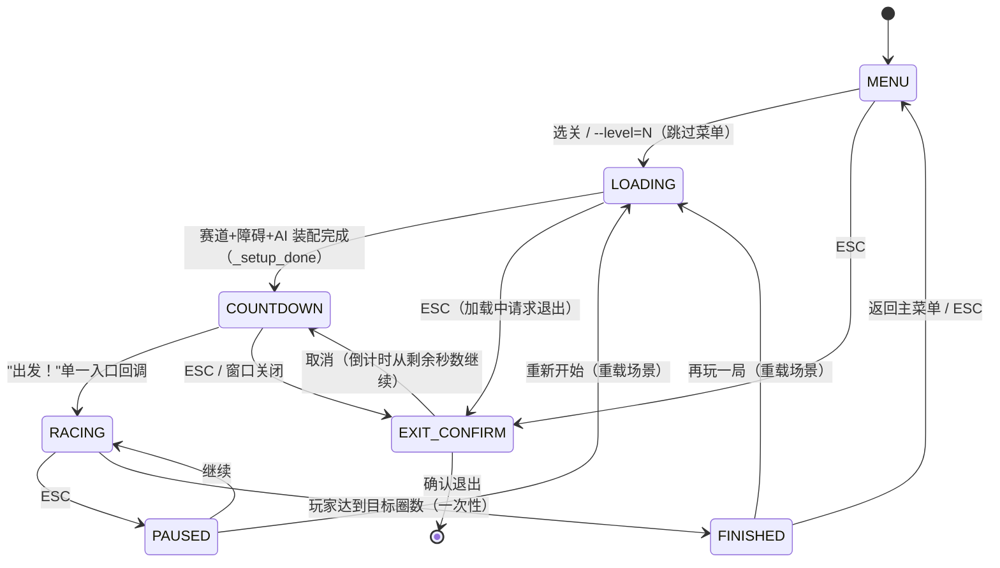
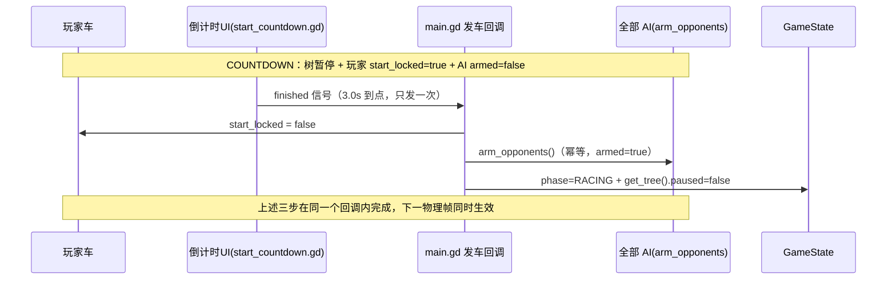

# Godot Racer · 竞速系统策划案（Race System Design）

> 版本：v1.2 · 2026-10-19 · 状态：**D1 修订已批准实施**（2026-10-19 用户拍板，见 §11.1；v1.1 已随阶段一~三落地提交）
> 代码基线：commit `4cfb6a6`（2026-10-18 13:03），本地 `main` 与 `origin/main` 一致（`rev-list --left-right --count` = 0/0）
> 本文档**自包含**：不依赖对本仓库的历史对话即可独立阅读，可直接整篇交给外部 AI（如 ChatGPT）审阅或继续实施。
> 本文所有"已实现/未实现"结论均来自对上述基线的代码实读，标注了文件与行号证据；未实机运行、未提交为绿色的功能一律写入"未实现"。
> v1.1 修订记录（用户反馈驱动，见 §11.0）：C1 总时间起算点改到"出发！"；C2 AI 完赛后行为升格为待确认策划规则 P1；C3 名次/并列口径统一。
> v1.2 修订记录（2026-10-19 用户试玩反馈驱动，见 §11.1）：D1' 统一计时原点——圈速亦从"出发！"起算（首圈含起跑段），修订 R6/R15/AC-05，「总时间 ≡ 各圈之和」；「起步」分段行随之删除；附 D3 起点龙门架（跨线而立、立柱带碰撞）。

---

## 0. 文档目的与阅读路线

- **用途一（作品集）**：作为游戏策划岗位应聘作品，展示"把体验假设转成规则、配置与验收判据"的完整过程。
- **用途二（实施依据）**：作为下一轮开发的任务书；§10 给出最小改动方案，§12 给出下一轮最小任务清单。
- 阅读路线：§2 项目概况 → §3 现状核查（哪些已有、哪些缺）→ §4-§6 设计本体 → §9 验收用例 → §10 实施方案。

---

## 1. 一句话结论

**当前代码已有"完整的单机计时赛闭环"（选关 → 加载 → 玩家速度达 4 km/h 时 AI 才发车 → 计圈 → 玩家完赛结算 → 重开/回菜单），但缺少"竞速感"三件套：3 秒倒计时同步发车、实时名次、AI 完赛与胜负判定。** 本方案按三个阶段补齐（§10.3）：阶段一倒计时+同步发车（1 个新模块 + 5 个既有文件小改）、阶段二实时名次+胜负判定（再 1 个新模块）、阶段三结算页扩展；全程复用既有系统，不改车辆物理、AI 寻路与关卡参数。

---

## 2. 项目概况（零上下文读者须知）

| 项 | 值 |
|---|---|
| 项目 | Godot Racer —— Godot 4.4.1 单机 3D 赛车原型（5 关 / AI 对手 / 天气 / 验收驱动） |
| 工程根 | `godot-racer/`（即 `res://`）；仓库根 = 工作区本身 |
| 技术栈 | Godot 4.4.1 · Forward Plus · Jolt Physics · 物理固定 120 Hz · 渲染 60/120 FPS 可选 |
| 主场景 | `scenes/main.tscn`（脚本 `scenes/main.gd`，701 行）；主菜单 `scenes/menu.tscn` |
| 全局状态 | `scripts/game_state.gd`（autoload，403 行）：关卡选择、渲染设置、比赛相位 |
| 五关 | L1 晴 / L2 晴 / L3 雨夜 / L4 沙尘荒漠 / L5 雪地（配置在 `data/levels/*.tres`，经 `scripts/level_config.gd` 读取） |
| 核心玩法文件 | `scripts/vehicle.gd`（玩家车，1413 行）、`scripts/ai_opponent.gd`（AI，1686 行）、`scripts/racing_line.gd`（几何/限速唯一真相源）、`scripts/track_layout.gd` |
| 流程相关 | `scripts/opponent_spawner.gd`（对手生成与发车）、`scripts/finish_menu.gd`（结算）、`scripts/pause_menu.gd`（暂停）、`scripts/exit_confirm.gd`（退出确认）、`scripts/hud.gd`（HUD） |
| 验收体系 | 24 个 `--check=` 项 + 三道文本闸门；`--shot*` 截图族；`tests/` 场景测试 |
| 既有计划 | `plan/feature-race-start-results-1.md`（2026-10-17，status=Planned）即"倒计时同步发车 + 结算闭环"实施计划；本文档与其关系见 §3.3 |

**本项目的两条工程铁律（影响本方案的所有决策）**：

1. 游戏路径与验收路径尽量共用同一份核心代码——历史上曾因"游戏里 AI 抢跑、验收却通过"而返工（`scenes/main.gd` L274-281 的注释记录）。
2. TDD：先写失败用例，再最小实现；验收绑定 commit + 工作区状态；不为变绿放宽判据。

---

## 3. 现状核查报告（代码事实）

### 3.1 已实现的功能（有代码证据）

| # | 功能 | 现状描述 | 证据（文件:行） |
|---|---|---|---|
| A1 | 选关与赛前设置 | 菜单从 `.tres` 生成关卡按钮；极速滑条 80–240；AI 对手开关；60/120 FPS 开关；`--level=N` 可跳过菜单直进关卡 | `scripts/menu.gd:268-288`、`199-203`、`254-258`、`33-59` |
| A2 | 关卡装配 | `main.gd _ready()` 立即 `GameState.begin_race()` → 应用关卡配置 → `_after_world_ready()` 等赛道构建、连接检查点、建障碍、生成 AI（含物理基线采样），完成后置 `_setup_done` | `scenes/main.gd:182-186`、`189-285` |
| A3 | AI 生成与摆位 | 实例化 `race_car.tscn` 换 `ai_opponent.gd` 脚本；`_place_beside(player)` 与玩家**并排齐头**（横向 = 车宽 + 净距，夹在路面内）；注入极速/圈数/抓地力/障碍场/玩家车 | `scripts/opponent_spawner.gd:152-191`、`scripts/ai_opponent.gd:317-339` |
| A4 | 当前发车规则 | **旧规则**：`_process` 每帧轮询，玩家水平速度 ≥ 4 km/h 才 `arm_opponents()` 给全部 AI 置 `armed=true`；AI 不自行发车 | `scenes/main.gd:675-676`、`scripts/opponent_spawner.gd:195-217`、`scenes/main.gd:176` |
| A5 | 计圈与圈速 | 几何平面穿越判定（不用 Area3D 信号，避免高速漏检）；出生在线后，首次压线只开始计时、不计圈；之后每次压线计一圈并刷新末圈/最快圈；`current_lap_time()` 提供实时本圈计时 | `scripts/vehicle.gd:741-770`、`773-793`、`826-829` |
| A6 | 倒计时不计入圈速 | **已天然满足**：圈速起点是"出发后第一次压线"，不是场景加载完成时刻 | `scripts/vehicle.gd:773-781` |
| A7 | 玩家完赛判定 | `laps_done >= laps_target` → `race_finished` 信号 → `GameState.finish_race()` 一次性快照（相位门闩：仅 RACING、laps≥target 才接受，重复信号被忽略） | `scripts/vehicle.gd:791-793`、`scripts/game_state.gd:135-142`、`scenes/main.gd:288-293` |
| A8 | 结算页 | 全屏 CanvasLayer + 半透明遮罩，底层比赛画面冻结（`get_tree().paused = true`）；显示"比赛完成 / 完成 X/Y 圈 / 末圈 / 最快圈"；三个按钮：重新开始、返回选关（ESC）、退出游戏 | `scripts/finish_menu.gd:1-50`、`scripts/game_state.gd:135-142` |
| A9 | 重开与回菜单 | `restart_race()` = 清快照 + 重载当前场景；`back_to_menu()` = 回 MENU + 切菜单场景；暂停菜单也有"重新开始/返回选关" | `scripts/game_state.gd:145-152`、`scripts/pause_menu.gd:136-141` |
| A10 | 暂停/退出确认 | ESC 暂停（继续/重新开始/返回选关/退出）；退出走确认覆盖层，取消后按原相位恢复暂停态；`--check`/`--shot` 自动退出不弹窗 | `scripts/pause_menu.gd:1-145`、`scripts/game_state.gd:155-177` |
| A11 | HUD 信息 | 车速、本圈实时计时、上圈、最快圈、圈数 X/Y、"开反了"提示、小地图（玩家点 + AI 点 + 障碍点，M 键开关） | `scripts/hud.gd:263-293`、`187-199` |
| A12 | AI 进度读数 | AI 已维护 `_progress = 压线次数 × 赛道长 + 当前弧长`（注释明言"用于名次排序"），并公开 `progress()` / `laps_done()` / `speed_kmh()` | `scripts/ai_opponent.gd:915-926` |
| A13 | 名次基础设施 | AI 的 `progress()` 即排序键；但**全库无任何消费方**（无 HUD 名次、无结算名次） | 全库检索 `progress()` 仅定义处 |
| A14 | 验收与自动化 | 24 个检查项；`aistart` 验收当前语义 = "玩家静止时 AI 不动 → 玩家全油门 → AI 数帧内发动"（正是旧发车规则的机器化）；`tests/` 有结算流程场景测试与"自动模式下不得接交互结算"的守卫测试 | `scripts/checks/ai.gd:881-937`、`tests/rel_final_mode_guard_test.gd:95-148`、`tests/release_flow_scene_test.gd` |

### 3.2 未实现的策划需求（缺口清单）

| # | 缺口 | 说明 |
|---|---|---|
| G1 | 3 秒倒计时 | `game_state.gd` 无 LOADING/COUNTDOWN 相位；全库无 `start_countdown.gd`；`_ready()` 第一行即 `begin_race()` 进入 RACING |
| G2 | 同步发车 | 无"单一入口同时放开玩家与全部 AI"的机制；AI 发车挂在玩家速度轮询上（A4） |
| G3 | 赛前驾驶输入锁 | `vehicle.gd` 无 `start_locked`；装配/加载期间玩家按键即可驱动车辆 |
| G4 | 实时名次 | HUD 无名次标签；AI `progress()` 无消费方；玩家无等效进度读数被汇总 |
| G5 | AI 完赛处理 | AI 的 `race_finished` 信号**无人连接**（`scripts/ai_opponent.gd:914` emit 后无任何效果）；AI 完赛后继续在赛道上行驶 |
| G6 | 胜负判定 | 无"AI 先完赛 / 玩家先完赛"的分支处理；无最终名次表 |
| G7 | 成绩展示扩展 | 结算只有末圈/最快圈/圈数；无总时间、无名次、无对手成绩对比 |
| G8 | 倒计时期间交互 | `cancel_exit()` 只对 PAUSED/FINISHED 保持树暂停（`game_state.gd:171-177`）；若新增 COUNTDOWN 相位必须补，否则取消退出确认会提前解冻 |
| G9 | 重开后全流程 | `restart_race()` 在 reload 前直接 `begin_race()`（`game_state.gd:145-147`），新场景会跳过倒计时直接开跑 |
| G10 | 关闭 AI 时的完整流程 | `--aioff`/菜单开关可使 AI 不生成（`game_state.gd:389-395`），但倒计时/名次在该情形下的表现未有定义 |

### 3.3 与既有计划文档的关系

`plan/feature-race-start-results-1.md`（2026-10-17，status=Planned）已完整覆盖 G1/G2/G3/G8/G9 的实施设计（含任务拆分、替代方案分析、风险登记）。**本文档继承其全部结论，并新增两份它未覆盖的设计**：

1. **实时名次与名次算法**（G4）——计划只字未提；
2. **AI 完赛监听、胜负判定与成绩表**（G5/G6/G7）——计划 REQ-004 仅要求"完成时玩家和 AI 停止更新"（由树暂停天然满足），未定义 AI 先完赛怎么办。

另注：`NEXT_SESSION_RELEASE.md`（2026-10-18）明确该计划"留到单独对话"——**本轮对话即该单独对话**，可以正式启动。

---

## 4. 设计目标与体验原则

### 4.1 设计目标（按优先级）

| 目标 | 玩家体验目的 |
|---|---|
| T1 仪式感起跑 | 3-2-1-出发是赛车类型的**通用契约**；倒计时给玩家"进入比赛"的心理切换，也提供看清起点站位、对手分布的阅读时间 |
| T2 公平起跑 | AI 与玩家在同一时刻获得行驶能力；胜负可归因于驾驶判断，而不是"谁先谁后起步"或"菜单加载快慢" |
| T3 可读的竞争 | 实时名次让"我在追谁、谁在追我"一眼可读；没有名次的 AI 只是背景装饰，有了名次才是对手 |
| T4 明确的结束 | 玩家完赛、AI 完赛、比赛终止三种事件都有确定规则与成绩反馈；"输给 AI"不可怕，可怕的是不知道输没输、什么时候输的 |
| T5 低摩擦重试 | 再玩一局是一键的完整新比赛（重新倒计时），不是半场续跑 |
| T6 零物理侵入 | 全部流程规则不触碰车辆控制律、AI 寻路、关卡参数——玩法真实性不被流程代码污染 |

### 4.2 三条体验原则（规则取舍的判据）

1. **不让玩家为流程付出意外代价**：倒计时、暂停、复位不罚时、不取消资格、不吞按键（按住 W 到"出发！"应直接给油）。
2. **AI 是陪跑，不是裁判**：AI 卡死/失误不终止玩家比赛；玩家永远可以正常完赛并拿到成绩。
3. **平局与临界判定默认友好**：同帧双完赛等极小概率事件按"玩家不输"处理（单机原型没有电竞公平压力，只有挫败感管理）。

---

## 5. 竞速规则总设计

### 5.1 比赛相位状态机



要点：
- **LOADING 与 COUNTDOWN 是新相位**（当前只有 MENU/RACING/PAUSED/FINISHED/EXIT_CONFIRM）。
- 自动化路径（`--check=` / `--shot`）**不进 COUNTDOWN**：装配完成后直接可用，保持现有 24 项验收与截图族不被交互流程卡住。
- `--level=N` 属于**互动路径**（只是跳过菜单画面），照常走倒计时。

### 5.2 同步发车序列（唯一入口）



**"同步"的定义**：三步写在同一个回调里，因此玩家与 AI 的行驶能力在**同一个后续物理帧**同时获得。这是可断言的（验收用例 AC-03）。

### 5.3 规则条文（R1–R15）

| 规则 | 内容 | 玩家体验目的 | 代码落点（现状 → 目标） |
|---|---|---|---|
| R1 相位机 | 新增 LOADING（装配中）与 COUNTDOWN（倒计时中）；`prepare_race()` 清成绩并进 LOADING，`enter_countdown()` 只接受 LOADING 并进 COUNTDOWN + 暂停树 | 把"加载等待"与"比赛进行"显式分开；倒计时期间物理暂停，从机制上杜绝提前动 | `game_state.gd:19`（enum）→ +2 个相位与 2 个方法 |
| R2 倒计时 | `COUNTDOWN_SECONDS := 3.0` 单常量；显示 3/2/1 各 1 秒，到 0 触发一次 `finished`；"出发！"显示约 0.5s 后自动移除，不阻挡输入 | 类型标准仪式；3s 足够预备又不冗长；改时长只改一处常量 | 新增 `scripts/start_countdown.gd`（CanvasLayer，PROCESS_MODE_ALWAYS） |
| R3 倒计时冻结 | 倒计时只在 `phase == COUNTDOWN` 时用 `_process(delta)` 累计 → ESC 退出确认弹出时剩余时间冻结；取消后从原秒数继续 | 玩家不会被"退出确认对话框"偷走比赛时间 | `start_countdown.gd` + `game_state.gd cancel_exit()` 补 COUNTDOWN 保持暂停（G8） |
| R4 赛前输入锁 | LOADING 起玩家车 `start_locked = true`；锁定时 `_update_drive()`/`_update_steering()` 忽略油门/刹车/转向/手刹输入（保持既有怠速与物理，**不改任何控制律常量**）；"出发！"回调里**不** release 输入，按住 W 可直接给油 | 装配沉降期不误操作；保留"提前蓄力"的手感，不制造按键失灵感 | `vehicle.gd` `_physics_process` 两处更新函数开头早退 |
| R5 同步发车 | 见 §5.2：单一回调 = 玩家解锁 + `arm_opponents()` + 切 RACING 解冻，三步同帧 | 公平起跑（T2）；AI 不再等待玩家 4 km/h，玩家不按键 AI 也发车 | `main.gd` 编排；`opponent_spawner.gd` 删 `maybe_start_opponents` 与 `ai_start_speed_kmh`（A4 旧规则退役） |
| R6 圈速计时口径（v1.2 修订：与 R15 同原点） | 圈速从"出发！"瞬间起算（首圈含起跑爬行段）；倒计时与加载不计入任何一圈；GO 前本圈显示 `--:--.---` | 总时间 ≡ 各圈之和（赛车常识硬性要求，用户原话"绝不能留"）；真实赛车静止起步逻辑：首圈含起步反应时间；自动化路径（无"出发！"事件）保持"首次压线起表"旧口径，验收证据零变化 | `vehicle.gd` 新增 `start_line_crossed` 标志与 `begin_lap_timing()`，由唯一发车回调 `_on_race_go()` 在 `start_race()` 返回真时锚定；互动路径首发压线只标记、不完圈、不重新起表 |
| R7 实时名次 | 见 §5.4 算法；HUD 显示"名次 k / N"（N = 1 玩家 + AI 数）；关闭 AI 时显示"练习" | 竞争可读（T3）；AI 从背景板变成对手 | 新增 `scripts/race_position.gd`（纯计算 + 自建 HUD 标签，复用 AI 既有 `progress()`） |
| R8 名次锁定 | AI 一旦完赛即**锁定名次**（按完赛帧顺序排在前列），之后其 progress 继续增长也不影响名次表 | 防止"已完赛的 AI 还在赛道上刷进度反超"造成的名次错乱 | `race_position.gd` 排序键设计（见 §5.4） |
| R9 AI 完赛 | AI `race_finished` 接到 main：记录其名次/圈数/完赛帧；HUD 一次性提示"AI#n 已完赛"；**不终止比赛**。阶段二采用 P1-C：AI 继续按原控制律行驶，但退出车辆碰撞，保留场地碰撞（§5.5） | 玩家立刻知道"已经有人到了"；已完赛 AI 不再物理阻挡玩家 | `main.gd` 连接信号；`race_position.gd` 记账和碰撞层切换 |
| R10 比赛终止 | **唯一终止条件是玩家达到目标圈数**（或玩家主动退出/回菜单）。AI 全部完赛而玩家未完赛：HUD 提示"所有对手已完赛"，比赛继续 | 单机原型的结束条件必须唯一且可预期；AI 状态是信息，不是终止信号 | 现状已满足（A7），仅补提示 |
| R11 玩家完赛 | 现有一次性快照机制不变（重复信号被门闩忽略）；快照扩展：总时间、最终名次、全场成绩表 | 成绩可回味、可对比；面试作品里"结算页"是策划能力的直接展示 | `game_state.gd finish_race()` 快照加字段；`finish_menu.gd` 扩展展示 |
| R12 玩家复位 | R 键/自动脱困为既有行为：复位不赠圈（弧长穿越隔离）、不罚时、本圈计时继续 | 降低挫败，鼓励继续；与现有实现一致，**零改动** | 现状已满足（`vehicle.gd:759-767`），文档仅固化为规则 |
| R13 关闭 AI | `--aioff` 或菜单开关 → 不生成 AI；倒计时照常；名次区显示"练习"；结算只有玩家成绩 | 练习模式也享受完整流程；不让"关掉 AI"变成二等公民 | `game_state.gd:389-395` 已有 `effective_ai_count()`，新代码只读它 |
| R14 重开 | 再玩一局/暂停重开 = 清成绩 + 重载场景 → 新场景从 LOADING 开始（先 `prepare_race()` 再 reload），必然重新倒计时 | 重开是完整新比赛，不是半场续跑 | `game_state.gd restart_race()` 调整调用顺序（G9） |
| R15 总时间口径（v1.2 修订：与 R6 同原点） | **比赛总时间从"出发！"瞬间起算**（倒计时到 0、同步发车回调执行的那一刻），到玩家完赛（最后一次压线）止。~~与 R6 圈速口径**有意分离**~~（v1.2 修订：**与 R6 同原点**）——圈速度量单圈驾驶质量，总时间度量整场比赛耗时；两者同自"出发！"起算，于是 总时间 ≡ 各圈之和，「起步」段恒为 0（该 HUD 行同日删除） | 若总时间也按"首次压线"起算，玩家在起跑线附近等待或缓慢爬行时，总时间会漏掉这段真实发生的比赛过程，成绩不可比；从出发起算才完整反映实际比赛。两个口径同原点后数字永久对得上，「总时间 vs 本圈对不上」的试玩抱怨根除 | `game_state.gd` `race_start_ms`（GO 回调置 `Time.get_ticks_msec()`；自动化路径 `begin_race()` 同样置位保持口径一致）；`finish_race()` 算 `total` 写入快照；`vehicle.gd` `begin_lap_timing()` 读同一 `race_start_ms` 锚定圈钟（同源时钟，两个时钟同一时刻） |

### 5.4 名次与胜负算法（可断言的确定性规则）

**进度（progress）定义**（与 AI 既有公式逐字对齐，不造第二套）：

```
progress = 压线次数 × 赛道总长 + 当前弧长
```

- AI：`progress()` 现成（`ai_opponent.gd:917`）。
- 玩家：`压线次数 = laps_done + (current_lap_time() > 0 ? 1 : 0)`（`current_lap_time()>0` 等价于"已压过起点线且在计时"）；`当前弧长` 用赛道既有 API `nearest_on_centerline(car.global_position, -1.0)` 取。**无需给 vehicle.gd 加任何字段**——名次功能对车辆代码零侵入。
- 初始一致性：双方出生在起点门后方，弧长接近赛道总长、压线次数为 0，progress 同量级；发车压线后回绕到小弧长，progress 连续不反转（这正是 AI 注释里踩过的坑，`ai_opponent.gd:915-916`）。

**排序键**（每个采样时刻，实时名次与最终名次**共用同一把尺**）：

```
key(赛车) = (0, 完赛帧序号)  若已完赛
          = (1, -progress)   若未完赛
```

即：**已完赛者按完赛先后排在前，未完赛者按 progress 降序排在后**。玩家名次 = 玩家在排序中的 1 起位置。

**采样频率**：0.25 秒一次（4 Hz）刷新 HUD——肉眼足够，且每 0.25s 只对玩家做一次 `nearest_on_centerline` 查询，开销可忽略（AI 自己的 progress 是缓存字段，零成本）。

**临界规则（v1.1 统一口径，取代 v1.0 的"同帧完赛玩家优先"）**：

- **同帧完赛 = 并列，不拆名次**：玩家与 AI（或 AI 之间）在**同一物理帧**达到目标圈数时，判为并列，结算页显示"并列第 1"（或并列第 k），**不**拆成 1/2 名。这是本规则集的唯一同帧口径，实时 HUD 与最终成绩表都必须遵循——避免"实时显示第 2、结算却第 1"这类显示与成绩不一致。理由：单机原型没有电竞公平压力，同帧完赛概率极低，"并列"比"发明一条仲裁链"更诚实也更友好（§4.2 原则 3）。实现细节：玩家从物理帧发出完成信号时，等该帧其他车的完成回调记录后再写首次 snapshot；名次表一律按完赛帧序号排序，同帧即并列。
- progress 完全相等（float 级巧合）：排序稳定，**玩家不因此判负**（§4.2 原则 3）。
- 玩家完赛瞬间：为所有未完赛 AI 按其当时 progress 降序补齐名次，生成完整成绩表。

**边界测试要求（Phase 02 出口判据，AC-15）**——名次算法最大的风险不是均值场景而是四个临界点，每个都必须有机器断言：

1. **首次压线前**：双方出生在起跑线后方（`progress = 0 × 赛道长 + 大弧长`）。断言：名次为正整数、progress 非负、玩家未压线时压线次数按 0 计（与 AI 口径一致）。
2. **复位瞬间**：玩家 R 键/自动脱困复位到检查点后弧长回退 → progress 突降 → 名次下降（这是复位的应有惩罚，允许降），但断言：progress 不低于初始出生值、不出现 NaN、相邻采样帧名次不来回跳变（抖动）。
3. **跨圈瞬间**：压线帧 `progress = (n+1) × 赛道长 + ε`。断言：压线次数增加 1、弧长从赛道尾回绕到赛道头、圈数项恰增加一个赛道长度、累计 progress 不下降且名次不得瞬降。原“净增 ≥ 0.9 × 赛道长”与公式矛盾：跨线前后累计 progress 实际只净增起终点两侧行驶的几米；2026-10-18 经用户确认按此数学口径修订，不降低连续性要求。
4. **同 progress 平局**：显示并列名次，玩家不判负。

### 5.5 已定稿策划规则 P1：AI 完赛后继续行驶并退出车辆碰撞

> 状态：**2026-10-18 用户选定 C**。阶段一沿用旧行为；阶段二在 AI 首次完赛时移除其车辆碰撞层与车辆碰撞掩码，保留地面碰撞掩码和原 AI 驾驶逻辑。玩家不会再被已完赛 AI 阻挡；仍需真实画面核对可能的穿模，并做完整物理回归。

**问题陈述**：AI 达到目标圈数（完赛）后，若继续按原 AI 控制律在赛道上行驶，已获第一名的 AI 仍可能阻挡或碰撞尚未完赛的玩家——名次已锁定的失败者继续影响比赛结果，既有公平性问题，也有挫败感管理问题。

**候选方案与评估**：

| 方案 | 做法 | 优点 | 风险 / 成本 |
|---|---|---|---|
| A（现状，阶段一沿用） | 完赛后继续行驶，靠既有避让逻辑（`_avoid_player_lane`）减少干扰 | 零代码改动、零物理风险、零新 A/B 证据需求 | 上述公平性问题原样存在 |
| B 减速离场 | 完赛后把 AI 目标速度压到低值（或沿车道滑行至停止） | 尽快腾出赛道，视觉上"知胜负" | 需改 AI 目标速度逻辑 = 动 AI 行为；急减速有被玩家追尾的风险（Jolt 下碰撞可能把玩家弹失控）；需新回归证据 |
| C 退出碰撞（幽灵化） | 完赛后摘掉车辆碰撞位（layer/mask），视觉上仍行驶 | 完全消除物理干扰 | 改 collision layer 属物理行为改动；幽灵车与玩家可能穿模；AI 避让/自救若依赖碰撞查询可能行为异常；需新回归证据 |
| D 完赛停驶 | 方案 B 的停止特例：减速到 0 停在赛道旁 | 语义最"礼貌" | 停在路上就是路障，比继续开更糟；除非同时配 C，成本叠加 |

**执行口径**：AI 是竞速对手；完赛后仍保持视觉行驶，但不再发生玩家车碰撞。玩家与已完赛 AI 穿模不记惩罚（现有成绩系统也无碰撞惩罚）。物理和视觉风险用阶段二专项、相关物理检查与实际截图核对，未跑完前不得称为完整验收通过。

---

## 6. 异常与边界分支（E1–E14）

| # | 场景 | 规则 | 体验目的 |
|---|---|---|---|
| E1 | **AI 先完赛，玩家未完赛** | AI 成绩锁定 + HUD 提示；比赛继续；玩家完赛后结算显示完整名次表（AI 在前） | 知道输了、也知道输多少；不终止比赛避免"被强行判负"的突兀 |
| E2 | **玩家先完赛，AI 未完赛** | 树暂停冻结全场；成绩表按 E1 规则用当时 progress 补齐 AI 名次 | 完赛瞬间一切定格，成绩即所见 |
| E3 | **双方同帧完赛** | 见 §5.4 临界规则：双方并列第 1，不拆名次 | 友好默认，不为极小概率事件做复杂仲裁 |
| E4 | **AI 卡死/自救循环** | 不终止比赛、不罚玩家；结算如实显示该 AI 的实际圈数与"未完赛" | AI 是陪跑不是裁判；玩家体验不被他车异常污染 |
| E5 | **AI 完赛后与玩家接近** | 阶段二采用 P1-C：完赛 AI 继续驾驶，保留场地碰撞，退出车辆碰撞；玩家可以穿过已完赛 AI | 已锁名次的对手不再物理干扰玩家；穿模须做视觉核对 |
| E6 | **倒计时中按住 W** | 锁定期忽略输入；GO 不 release，下一物理帧直接给油 | 不吞按键（专项测试覆盖，见计划 TEST-003） |
| E7 | **倒计时中 ESC / 窗口关闭** | 退出确认照常弹出；倒计时冻结；取消后从剩余秒数继续 | 标准预期，无意外死亡 |
| E8 | **倒计时中 HUD 状态** | 车速 0、本圈 `--:--.---`、名次区显示"准备"；小地图可见（装配已完成，玩家可看清对手站位） | 倒计时期是"阅读赛场"时间，信息越多越有仪式感 |
| E9 | **再玩一局 / 暂停中重开** | 清成绩 + 重载场景 + 从 LOADING 重新走全流程（含重新生成 AI、重新倒计时） | 完整新比赛；旧 AI 节点随场景重载销毁，无残留 |
| E10 | **60 / 120 FPS** | 倒计时用 `delta` 累计，总时长与帧率无关；但改发车流程后 lap/opponents 日志全部变化，须按 §9 AC-13 双档重跑 | 帧率只影响顺滑度，不影响规则 |
| E11 | **关闭 AI（`--aioff`/菜单）** | 不生成 AI；倒计时照常；名次区"练习"；结算只有玩家成绩 | 练习模式也是完整流程 |
| E12 | **不限圈数关卡（laps_to_finish ≤ 0）** | 不触发完赛（既有行为），练习模式；名次仍显示 | 保留既有语义，不因本轮改动缩小功能 |
| E13 | **复位与压线** | 复位隔离窗内不判压线（既有 `_reset_isolate`），不赠圈 | 复位的公平性已由现有代码保证，固化为规则 |
| E14 | **自动化路径** | `--check=`/`--shot` 不进倒计时、不锁车；`aistart`/`aidiag` 改验新语义（经 main 暴露的同一发车入口，专项里直接触发"出发！"而不等真实 3 秒） | 验收与游玩共用同一入口——本项目用返工换来的铁律 |

---

## 7. UI 信息设计

### 7.1 倒计时层（新增 `start_countdown.gd`）

| 元素 | 规格 | 目的 |
|---|---|---|
| 层级 | CanvasLayer，`layer` 高于 HUD（建议 100），`process_mode = ALWAYS` | 暂停时仍可显示与计时 |
| 数字 | 3 / 2 / 1 居中大字（≥72px，白字黑描边，系统字体显式指定中文字形） | 追尾视角下视线正中，无需低头 |
| "出发！" | 到 0 显示约 0.5s 后自动移除 | 明确"现在可以走了"的瞬间 |
| 输入 | `mouse_filter = IGNORE`，不 `set_input_as_handled` | 不阻挡驾驶输入 |

### 7.2 HUD（改造 `hud.gd` 或由名次模块自建标签）

| 元素 | 规格 | 目的 |
|---|---|---|
| 名次标签 | "名次 2 / 3"，位于圈数标签旁；LOADING/COUNTDOWN 显示"准备"；无 AI 显示"练习" | 一眼可读的竞争位置 |
| 总时间标签 | "总时间 mm:ss.mmm"，与圈速区同列；GO 前显示 `--:--.---`（R15：从出发起算） | 整场比赛的耗时一眼可读；与圈速分离的两个指标各司其职 |
| AI 完赛提示 | 一次性文字（如"AI#1 已完赛"），数秒后淡出；做法参照"开反了"提示条的运行时自建先例 | 关键事件不淹没在日志里 |

### 7.3 结算页（改造 `finish_menu.gd`）

| 区域 | 内容 |
|---|---|
| 标题 | 比赛完成 |
| 结果行 | 最终名次 第 X 名（共 N 车）；第 1 名时附加"你获得了冠军" |
| 成绩区 | 完成 X/Y 圈 · 总时间 mm:ss.mmm · 末圈 · 最快圈 |
| 对手成绩表 | 每行：名次 · AI#n · 圈数 · 状态（完赛/未完赛）；玩家行高亮 |
| 按钮 | 返回主菜单（= 现"返回选关"）/ 再玩一局（= 现"重新开始"）/ 退出游戏（走既有退出确认，不直接退出） |

---

## 8. 配置字段

| 字段 | 位置 | 默认 | 说明 |
|---|---|---|---|
| `COUNTDOWN_SECONDS` | 新增 `start_countdown.gd`（唯一常量） | 3.0 | 改时长只改这一处；**不放进 LevelConfig**——倒计时是流程参数不是关卡设计参数，避免动关卡数据契约 |
| `LOADING` / `COUNTDOWN` | `game_state.gd` `enum Phase` | — | 新相位 |
| `start_locked` | `vehicle.gd` | `false` | 自动化路径默认不锁；仅互动装配时置 true |
| `finish_snapshot` 扩展 | `game_state.gd` | — | 新增 `total`（总时间，R15）、`position`、`field_size`、`entrants`（成绩表数组）；旧键不动，`finish_menu.gd` 用 `get()` 读，向后兼容 |
| `race_start_ms` | `game_state.gd` | 0 | GO 瞬间置 `Time.get_ticks_msec()`（自动化路径在 `begin_race()` 置位，口径一致）；`finish_race()` 据此算 `total`。**已知取舍**：墙钟计时，暂停会计入总时间（与既有圈速口径 `current_lap_time()` 同源，保持两个指标同一时间基；要"暂停不计时"需同时改圈速口径，会影响全部既有圈速证据，列为后续候选） |
| 删除 | `main.gd` `ai_start_speed_kmh`（4.0）与 `opponent_spawner.maybe_start_opponents()` | — | 旧发车规则随同步发车退役 |

**明确不动**：`LevelConfig`（关卡参数契约）、`vehicle.gd` 全部控制律常量、`ai_opponent.gd` 寻路与限速、`racing_line.gd` 公式、24 个验收项的**数量**。

---

## 9. 验收用例（AC-01 – AC-14）

> 判据口径沿用仓库铁律：每项必须有最终 PASS/FAIL 标志与进程退出码 0；不止看中途日志；物理检查串行；lap 类注意双稳态（先同代码两跑定模式再比对）。

| # | 用例 | 必须观察到 | 类型 |
|---|---|---|---|
| AC-01 | 任一关进入，装配期间按住 W | LOADING 中无主动驱动力、无前进位移（允许静态沉降）；装配完才出现数字 3 | 场景测试 |
| AC-02 | 倒计时 3 秒，60/120 FPS 各一次 | 3/2/1 各约 1s，总时长与帧率无关；倒计时期间玩家与 AI 均无主动位移 | 场景测试 ×2 |
| AC-03 | **同步断言** | "出发！"回调同一帧内：玩家 `start_locked=false`、全部 AI `armed=true`、phase=RACING、树解冻 | 场景测试 |
| AC-04 | 玩家完全不按键、AI 开启 | GO 后 AI 自行达到 ≥10 km/h（不再等待玩家 4 km/h） | 场景测试 |
| AC-05 | 计时口径（v1.2 修订） | GO 前本圈与总时间均显示 `--:--.---`；**GO 即开始圈速计时**（互动路径首发压线只标记、不完圈）；倒计时不计入任何一圈；**总时间 = 完赛时刻 − GO 时刻**（R15），与圈速**同原点**（总时间 ≡ 各圈之和，末圈完赛与 `race_finished` 同帧） | 场景测试 |
| AC-06 | 名次正确性 | 构造场景（AI 在前/玩家超越）：HUD 名次随之正确变化；AI 完赛锁定名次后不再被反超 | 场景测试 |
| AC-07 | 玩家完赛一次性 | 重复发送完成信号只出一个结算页；快照不变；玩家/AI/计时停住 | 场景测试（已有先例扩充） |
| AC-08 | AI 先完赛 | AI 成绩锁定 + HUD 提示 + 比赛继续；玩家完赛后成绩表含双方名次 | 场景测试 |
| AC-09 | 关闭 AI | 无 AI 节点、倒计时照常、名次区"练习"、可正常完赛 | 场景测试 |
| AC-10 | 倒计时 ESC / 取消 / 窗口关闭取消 | 确认框期间剩余秒数冻结；取消回原秒数继续；比赛仍暂停 | 场景测试 |
| AC-11 | 再玩一局 | 成绩清零、AI 重新生成、重新倒计时；旧节点无残留（孤儿节点 0） | 场景测试 |
| AC-12 | 自动化不卡住 | `--check=`、`--shot`、Quick 15/15、全量 20/20、最终退出码 0；`aistart`/`aidiag` 验新语义 | 套件 |
| AC-13 | 双帧率关键回归 | 60/120 两档 ×（lap 3 次 + opponents L4 3 次 + opponents L5 3 次），判据与 60 FPS 完全相同，记录卡住/复位/碰撞/完成状态 | 长时跑圈（约 2 小时机时，需用户排期） |
| AC-14 | 文本闸门 | 若改 `godot-racer/docs/*.md` 或 README：三道文本闸门复跑全绿（注意"全部 N 项"措辞与反引号路径两条误伤规则） | 闸门 |
| AC-15 | 名次边界（Phase 02） | §5.4 四个临界点逐个断言：首次压线前（名次为正、progress 非负）、复位瞬间（允许降、不回跳、无 NaN）、跨圈瞬间（压线次数 +1、弧长回绕、圈数项 +1 个赛道长度、累计 progress 不降、名次不瞬降）、同 progress 平局（显示并列、玩家不判负） | 场景测试 |
| AC-16 | 总时间口径（Phase 01 即验） | GO 瞬间 `race_start_ms` 置位；完赛快照 `total ≈ 墙钟差`；重开后 `total` 归零重算 | 场景测试 |

---

## 10. 最小改动实施方案

### 10.1 原则

- **复用优先**：`GameState` 相位机、`finish_menu` 快照机制、`exit_confirm`、`pause_menu`、`opponent_spawner.arm_opponents()`、`vehicle.gd` 计圈、AI `progress()`——全部已有，不造第二套。
- **新代码只有一个新文件**（`start_countdown.gd`）+ 一个名次模块（`race_position.gd`），均 ≤ 200 行、无 `class_name`（消费方 `preload`，手写 `.uid`）——遵守本仓库模块约定与 1000 行向前约束。
- **车辆/AI/关卡参数零改动**；`vehicle.gd` 只加一个输入门闩的早退分支。
- **TDD**：每步先写失败测试再实现；每步独立可回退；验收绑定 commit。

### 10.2 文件清单与改动内容

| 文件 | 改动 | 行数量级 |
|---|---|---|
| `scripts/game_state.gd`（改） | +LOADING/COUNTDOWN 相位；`prepare_race()`（清成绩、解暂停、进 LOADING）；`enter_countdown()`（仅接受 LOADING）；`restart_race()` 改为 prepare + reload；`cancel_exit()` 保持 COUNTDOWN 暂停；`finish_snapshot` 加 4 个字段 | +40 |
| `scripts/start_countdown.gd`（**新增** + `.uid`） | 倒计时 UI；`COUNTDOWN_SECONDS := 3.0`；`finished` 信号；`PROCESS_MODE_ALWAYS`；只在 COUNTDOWN 相位累计 | ~120 |
| `scripts/race_position.gd`（**新增** + `.uid`） | 名次纯计算（§5.4 算法）+ 自建 HUD 标签与 AI 完赛提示；0.25s 采样；注入玩家车/AI 数组/赛道 | ~150 |
| `scenes/main.gd`（改） | `_ready()` 区分互动/自动化路径；`_after_world_ready()` 装配完成后 `enter_countdown()` + 挂倒计时 UI；新增唯一发车回调（三步同帧）；连接 AI `race_finished`；名次模块接线；`_on_race_finished` 组装扩展快照；删 `ai_start_speed_kmh` 与 `_process` 轮询分支 | +60/-15 |
| `scripts/vehicle.gd`（改） | `start_locked` 变量；`_update_drive()`/`_update_steering()` 开头锁定时早退（保持既有怠速物理） | +12 |
| `scripts/opponent_spawner.gd`（改） | 删 `maybe_start_opponents()`；`arm_opponents()` 保持（幂等）；更新文件头注释 | -12 |
| `scripts/finish_menu.gd`（改） | 按钮文案（返回主菜单/再玩一局/退出游戏）+ 名次/总时间/对手成绩表展示（`get()` 读快照，向后兼容） | +50 |
| `scripts/checks/ai.gd`（改） | `aistart`/`aidiag` 改验同步发车语义（经 main 同一发车入口，专项直接触发"出发！"） | ±30 |
| `scripts/hud.gd`（改） | 如名次标签不放 `race_position.gd` 自建，则在此加（倾向前者，本文件尽量不动） | 0~+15 |
| `tests/`（新增） | `countdown_scene_test.gd`（AC-01~05,10）、`race_position_test.gd`（AC-06,08）、`finish_results_test.gd`（AC-07,09,11）；TDD 先红 | ~300 |
| 文档 | `godot-racer/docs/portfolio-design.md` "公平起跑"段落在实现后更新（该文件在文本闸门扫描范围，注意措辞）；`docs/testing.md` 记录新语义；README 玩法段同步 | — |

### 10.3 实施步骤（三阶段，2026-10-18 用户批准）

> 阶段划分原则（用户指示）：每个阶段独立完成并验证，不与下一阶段同时开发；阶段一的成果（倒计时+同步发车）不依赖名次系统即可验收。旧 S0–S8 编号的映射见每阶段末尾。

#### 阶段一：倒计时与同步发车（本轮执行）

| 步骤 | 内容 | 出口判据 |
|---|---|---|
| 1.0 基线与红测 | 记录 HEAD/status；新建 `tests/countdown_scene_test.gd`（AC-01~05、10、11、16）对基线跑红 | 红日志归档 |
| 1.1 相位 | `game_state.gd` 相位与方法扩展（LOADING/COUNTDOWN、`prepare_race`/`enter_countdown`/`start_race`、`race_start_ms`、`restart_race`/`cancel_exit` 调整、`finish_race` 写 `total`） | 单测绿 |
| 1.2 门闩 | `vehicle.gd start_locked` + 两个更新函数早退 | AC-01 红转绿 |
| 1.3 倒计时+发车 | 新增 `start_countdown.gd`（+手写 `.uid`）；main 接线与唯一发车回调（三步同帧）；退役 `maybe_start_opponents` 与 4 km/h 轮询 | AC-02~05、16 绿 |
| 1.4 退出取消/重开 | `pause_menu.gd` 补 COUNTDOWN 分支；`cancel_exit` 保持 COUNTDOWN 暂停；重开必然重新倒计时 | AC-10、11 绿 |
| 1.5 自动化适配（D1） | `aistart`/`aidiag` 改验同步发车语义（经 main 暴露的同一发车入口）；适配 `release_flow_scene_test.gd` 新流程 | 两个检查项绿；判据串不变、项数不变 |
| 1.6 验证链 | lint → parse-check → countdown 场景测试 → Quick 15/15 → 全量 20/20 | 全部有退出码与 PASS 标志；双帧率回归按 D2 排期 |

（对应旧编号 S0+S1+S2+S3+S6 与 S7 的阶段一部分。）

#### 阶段二：实时名次与胜负判定

| 步骤 | 内容 | 出口判据 |
|---|---|---|
| 2.1 名次模块 | 新增 `race_position.gd`（§5.4 算法 + HUD 标签 + AI 完赛提示）+ main 接线 | AC-06、AC-15 绿 |
| 2.2 AI 完赛监听 | main 连接 AI `race_finished`；名次锁定（R8）；HUD 一次性提示 | AC-08 绿 |
| 2.3 胜负判定 | 唯一终止条件 = 玩家完赛（R10）；AI 先完赛不终止、只锁名次+提示；最终名次表生成 | 双车竞速（当前五关均 1 台 AI）端到端绿 |
| 2.4 P1 定稿 | AI 完赛后行为定稿（§5.5 三候选选一）；若选 B/C，先评估物理风险并单独立项回归 | 用户签字 |

（对应旧编号 S4 + S5 的"完赛"部分。当前五关均配置 1 台 AI，先把双车竞速做扎实，不为作品集强行支持多车混战。）

#### 阶段三：结算页面扩展与收尾

| 步骤 | 内容 | 出口判据 |
|---|---|---|
| 3.1 快照扩展 | `finish_snapshot` 加 `total`/`position`/`field_size`/`entrants` | AC-16 全绿 |
| 3.2 结算页改版 | `finish_menu.gd`：结果行（名次/冠军文案）、总时间、最快圈、对手成绩表、按钮文案（返回主菜单/再玩一局/退出游戏）——**沿用 CanvasLayer，不建独立场景**（D6） | AC-07、09、11 绿 |
| 3.3 HUD 展示 | 名次标签 + 总时间标签 + AI 完赛提示（§7.2） | 与结算页口径一致 |
| 3.4 截图与文档 | 保存实际游戏截图；整理 UI 设计说明与功能规则；更新 `portfolio-design.md`/`testing.md`/README → 三道文本闸门 → 显式路径提交 → push → 报"本地 vs origin 一致" | 闸门全绿；0/0 |

（对应旧编号 S5 的"结算"部分 + S8。）

### 10.4 与旧规则的差异声明（供评审）

| 变化 | 旧 | 新 | 影响面 |
|---|---|---|---|
| AI 发车条件 | 玩家速度 ≥4 km/h | 倒计时到点同步发车 | 游戏体验 + `aistart`/`aidiag` 语义（**已批准**，见 §11.1 D1） |
| 重开流程 | reload 前直接 RACING | reload 前先进 LOADING，重走倒计时 | 暂停/结算两个入口 |
| `main.gd` `_process` | 每帧轮询玩家速度 | 轮询分支删除 | 微小性能收益 |

---

## 11. 用户批准记录（2026-10-18）与风险

### 11.0 v1.1 三处规则修正（用户反馈 → 本文档修订）

| # | 用户反馈 | 本文档修订 |
|---|---|---|
| C1 | 比赛总时间的起算点需要重新定义：圈速和总时间是两种不同指标；否则玩家在起跑线附近等待或移动时，总时间无法完整反映实际比赛过程 | 新增 **R15**：总时间从"出发！"瞬间起算；圈速沿用现有压线判定（R6）；`race_start_ms` 配置字段与已知取舍（墙钟/暂停计入）写入 §8；AC-05/AC-16 覆盖 |
| C2 | AI 完赛后继续驾驶有公平性问题：已第一名的 AI 仍可能阻挡/碰撞未完赛的玩家 | 升格为**待确认策划规则 P1**（§5.5）：三候选方案 + 物理风险评估 + 定稿前必须回答的三个问题；**阶段一不修改 AI 完赛行为**（用户决定 D3） |
| C3 | 实时名次与并列规则需要专门测试；"同帧完赛玩家优先"与"并列第一"两个口径必须统一，避免显示名次与最终成绩不一致 | §5.4 临界规则重写：**唯一口径 = 同帧完赛并列、不拆名次**（删除"玩家优先"）；实时与最终名次同一把尺；新增四个临界点边界测试要求（AC-15） |

### 11.1 决议记录（D1–D6，用户 2026-10-18 批准）

| # | 事项 | 决议 | 生效范围 |
|---|---|---|---|
| D1 | `aistart`/`aidiag` 断言语义变更 | ✅ **批准**改为同步发车语义（经 main 暴露的同一发车入口，专项直接触发"出发！"而不等真实 3 秒）；**不得放宽其他判据**；检查项数量不变（全量仍 20 项、Quick 仍 15 项） | 阶段一步骤 1.5 |
| D2 | 双帧率回归机时 | ✅ **同意安排**；约 2 小时只是预估，实际耗时以运行结果为准 | 阶段一验证后 |
| D3 | AI 完赛后是否继续碰撞 | ✅ **先确定设计，阶段一不修改其行为**（沿用"继续行驶"）；升格为 P1（§5.5），阶段二前定稿 | P1 / 阶段二 |
| D4 | 倒计时时长 | ✅ 采用 **3.0 秒**（`COUNTDOWN_SECONDS` 单常量）。曾评估 5s：类型契约（3-2-1 是赛车通用语言）与重试摩擦（作品集会反复开局）占优，维持 3s；阅读赛场的时间由 LOADING + 可见小地图（E8）分担。**验收绿后做一次 3s/5s 非正式 A/B 按手感复核**（改一个常量即可） | 阶段一 |
| D5 | 同帧完赛与平局规则 | ✅ 统一口径：**同帧完赛 = 并列第 1（不拆名次）**；实时名次与最终成绩同一把尺；同 progress 玩家不判负 | 阶段二（规则已写入 §5.4） |
| D6 | 结算页形态 | ✅ 继续复用现有全屏 CanvasLayer 结算界面（`finish_menu.gd` 扩展），不另建完整场景 | 阶段三 |
| D7 | P1 与 AC-15 跨圈判据 | ✅ 用户选定 **P1-C**（已完赛 AI 退出车辆碰撞、继续行驶）；✅ 确认以“圈数项 +1 个赛道长度且累计 progress 不降”替换数学矛盾的“净增 ≥0.9×赛道长” | 阶段二；完整物理与视觉回归仍待取证 |

### 11.2 其他已识别风险（继承自计划 RISK-001~005，阶段一仍需盯防）

- 树暂停必须在装配（含 `_avg_physics_ms` 的 `await`）之后进入——LOADING 期间暂停会让 `await physics_frame` 的基线采样永不返回（装配死锁）。
- GO 回调不能原样调用 `begin_race()`：它会 `release_drive_input()`，把玩家按住的方向键吞掉（E6"出发！前按住 W 应直接给油"）。故新增不释放输入的 `start_race()`。
- `cancel_exit()` 必须补 COUNTDOWN 保持暂停，否则取消退出确认会提前解冻、倒计时与物理一起恢复。
- `restart_race()` 必须先 `prepare_race()` 再 reload，否则新场景跳过倒计时直接开跑。
- 不得拿旧 Quick/aistart 绿色冒充新需求通过；`aistart`/`aidiag` 改语义后旧日志全部作废。
- **aidiag 任务 15 组测量窗口随同步发车修正（2026-10-18 实施记录）**：同步发车后两车必然贴身若干秒（并排发车是设计行为），贴身阶段 AI 目标速度由避让逻辑（跟车限速/横偏限速）主导，不是「AI 能跑多快」的测量对象。旧窗口（发车后 2s 起 22s）实测把「贴着限制跑」稀释到 30.1%（假红）。修正：能力指标（贴着限制跑/被钉住/最大目标/近物理上限）窗口改为 **AI 离玩家 ≥30m（`AI_FREE_RUN_GAP_M`）之后 22s**，超时 20s 未脱离即报错；**停顿（>1.5s <5km/h）与超物理上限两项刻意保持发车后全程窗口**（更严，不随能力指标缩小）。全部阈值（60%/50%/110 km/h/不得超速）一个未改。修正后实测：贴着限制跑 78.4% ✔、被钉住 0.0% ✔、超速 0 ✔（全程 3964 点）、最长低速段 0.03s ✔（证据 `godot-logs/phase1-aidiag2.log`；修正前 `phase1-aidiag.log`）。
- **倒计时场景测试 E6 断言的按键时机（2026-10-18 实施记录）**：`prepare_race()` 与 `cancel_exit()` 都会 `release_drive_input()`，因此「按住 W 到出发不吞键」必须在 ESC→取消之后、倒计时稳定期间按键才对应真实玩家行为；更早按会被清掉（曾因此假红 0.0 km/h，已修，证据 `phase1-countdown-green2.log` 19/19）。
- 历史迁移闸门 `godot-logs/split-checks-ai-structcheck.ps1` 与 `split-opponent-structcheck.ps1` 在**未改动基线**上已红（过期断言：期望 26 分发项/2577 行等），不是现行验收链的活闸门；现行活闸门 = lint → parse-check → run-all-checks（Quick 15 / 全量 20）+ tests/ QA 门。

---

## 12. 本轮（阶段一）开发最小任务清单

> 已获用户批准（2026-10-18，含 D1–D6）。严格执行 TDD：每步先红后绿；每步独立可回退；不改车辆控制律、AI 寻路、关卡参数与 20 个验收项的数量。

1. **1.0 基线与红测**：HEAD `4cfb6a6` 起；新建 `tests/countdown_scene_test.gd`（COUNTDOWN 相位/输入锁/同步发车同帧断言/ESC 冻结/重开重来/总时间口径）对基线跑红，日志归档 `godot-logs/`。
2. **1.1 相位**：`game_state.gd` 增加 LOADING/COUNTDOWN；新增 `prepare_race()` / `enter_countdown()` / `start_race()`（GO 专用，不释放输入）；`race_start_ms` + `finish_race()` 写 `total`；`restart_race()` 改 prepare+reload；`cancel_exit()` 保持 COUNTDOWN 暂停。
3. **1.2 门闩**：`vehicle.gd` 增加 `start_locked`（默认 false，自动化路径不锁）；`_update_drive()` / `_update_steering()` 开头锁定时早退——不动任何控制律常量。
4. **1.3 倒计时+发车**：新增 `scripts/start_countdown.gd`（CanvasLayer·ALWAYS·`COUNTDOWN_SECONDS := 3.0`·`finished` 信号）+ 手写 `.uid`；`main.gd` `_ready()` 区分互动/自动化路径、装配完成进 COUNTDOWN 并挂 UI；唯一发车回调 `_on_race_go()` 三步同帧（解锁 + `arm_opponents()` + `start_race()`）；删除 `ai_start_speed_kmh`、`_process` 轮询分支与 `opponent_spawner.maybe_start_opponents()`。
5. **1.4 退出取消/重开**：`pause_menu.gd` 补 COUNTDOWN 分支（ESC → 退出确认，取消后从剩余秒数继续）；验证重开必然重新倒计时。
6. **1.5 自动化适配（D1）**：`checks/ai.gd` 经 setup 注入 GO 回调；`run_ai_start` 改验同步发车（不抢跑 → GO 同帧断言 → 无玩家输入下 AI 自加速 ≥10 km/h），判据串"并排发车验收 ✔"不变；`run_ai_diag` 改走 GO 入口，"AI 诊断 ✔"判据串与全部采样不变；适配 `tests/release_flow_scene_test.gd`。
7. **1.6 验证链**：lint → parse-check → countdown 场景测试绿 → `--check=aistart` / `--check=aidiag` 绿 → Quick 15/15 → 全量 20/20；双帧率回归（AC-13）按 D2 排期，不在本轮强跑。
8. **阶段二/三**：见 §10.3，本轮不启动。

---

## 附录 A：本策划案对应的代码事实速查

| 主题 | 文件:行 |
|---|---|
| 相位枚举与状态转换 | `scripts/game_state.gd:19`、`101-152`、`155-177` |
| 当前发车规则（4 km/h） | `scenes/main.gd:176`、`675-676`；`scripts/opponent_spawner.gd:195-217` |
| 装配流程 | `scenes/main.gd:182-186`、`189-285` |
| 计圈/完赛 | `scripts/vehicle.gd:741-793`、`797`、`826-829` |
| AI 进度/完赛信号 | `scripts/ai_opponent.gd:30`、`882-926` |
| 结算 | `scripts/finish_menu.gd:1-50`；`scenes/main.gd:288-293` |
| HUD | `scripts/hud.gd:187-199`、`263-293` |
| aistart/aidiag 语义 | `scripts/checks/ai.gd:881-937`（旧语义：玩家速度触发；阶段一改验同步发车，D1 已批准） |
| 倒计时模块（阶段一新增） | `scripts/start_countdown.gd`（本文档 §5.2/§7.1 规格；尚未创建） |
| 关卡规则字段 | `scripts/level_config.gd:50-56` |
| 既有实施计划 | `plan/feature-race-start-results-1.md` |
| 交接状态（倒计时计划被搁置的记载） | 仓库根 `NEXT_SESSION_RELEASE.md` §4 范围边界 |
